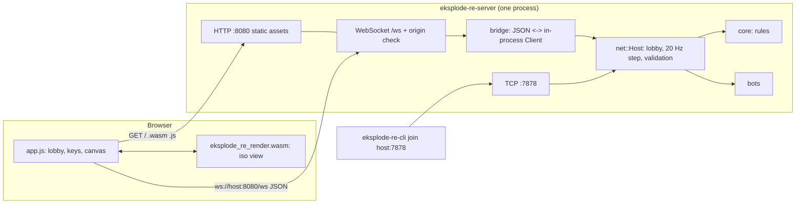

# Implementation Plan: Web Client and Project Documentation

**Branch**: `002-web-client` | **Date**: 2026-10-22 | **Spec**: [spec.md](spec.md)

**Input**: Feature specification from `/specs/002-web-client/spec.md`, plus the planning notes: fix the CLI connection (Enter does not work), create the backend that launches a WASM-based server delivering the graphics and new connections, then add the CLI option.

## Summary

Add a headless **game server** (`eksplode-re-server`) that does two jobs on one machine: it hosts the existing authoritative match (TCP, for terminal clients) and it serves a **web page** whose graphics run as **WebAssembly** (isometric view, coloured cubes) and whose connections arrive over **WebSocket** using the same JSON protocol as the terminal clients. Browser, terminal and bot players share one match. Same-origin only by default; other origins need an explicit option that prints a CORS warning.

Work is staged as the user asked: **(A)** fix the terminal lobby/start problem, **(B)** build the backend and the WASM page, **(C)** add the CLI options (terminal join of the server, `host --web-port`), **(D)** write the README and architecture documentation.

The native macroquad window (stage 4 of feature 001) is **dropped**; tasks T070-T087 of feature 001 are closed as "replaced by 002". The uncommitted GUI-preparation edit in `game/crates/cli/src/app.rs` is reverted.

## Root cause of "Enter does nothing"

Reproduced with a pseudo-terminal harness (`/tmp/pty_enter.py`, to be turned into a repository test):

| Input sent to the host lobby | Result |
|------------------------------|--------|
| CR (`\r`), CRLF, kitty `ESC[13u` | match starts |
| **LF (`\n`, Ctrl+J)** | **nothing happens, no message** |
| Enter pressed in a **joined** (non-host) client | nothing happens, no message |
| Host start refused by the server (e.g. a match is running) | silently ignored |

Findings: (1) in raw mode crossterm reports LF as `Ctrl+J`, our handler drops modifiers and treats it as the letter `j`; some terminals/keyboards send LF for Enter. (2) Only the process that owns the `Host` can start a match, so a joined client has no way to start, and (3) every refusal is silent. The fix: normalise key events (Enter, CR, LF, Ctrl+J, Ctrl+M), let the **lobby owner** (lowest human slot) start the match from any client through new protocol messages, and always answer a refused command with a visible `Error` (`NotOwner`, `CannotStart`, `WrongPhase`).

## Technical Context

**Language/Version**: Rust (toolchain here: nightly 1.92; code is stable-compatible, edition 2021); browser side: ES2020 JavaScript module + WebAssembly (no frameworks, no bundler, no npm install)

**Primary Dependencies**: existing `serde`, `serde_json`, `ratatui`; new for the server: `tungstenite` (blocking WebSocket, no async runtime; `sha1` and `base64` come with it). The WASM crate depends only on `eksplode-re-core` (feature `serde`) and `serde_json`. No `wasm-bindgen`, no `tokio`, no `axum`

**Storage**: N/A. Web assets are embedded in the server binary (`include_bytes!`); the built `.wasm` is committed under `crates/web/assets/` so nobody needs a wasm toolchain to run the game

**Testing**: `cargo test --workspace`; WebSocket and HTTP integration tests with real sockets (tungstenite client as dev-dependency); `node --test` for the JS and for the WASM module loaded in Node (skipped with a notice if `node` is missing); pseudo-terminal regression test for Enter; manual browser checklist for visual checks; `cargo clippy`, `cargo fmt`

**Target Platform**: Linux first for the server and terminal client; browser: current Chrome/Edge, Firefox, Safari on desktop

**Project Type**: Cargo workspace (libraries + three binaries: `eksplode-re-cli`, `eksplode-re-server`) plus static web assets and one `wasm32-unknown-unknown` library

**Performance Goals**: simulation 20 Hz; browser draws at display refresh rate with interpolation; < 200 ms key-to-screen for 95% of actions on LAN; WASM module <= 300 KB; page total <= 500 KB

**Constraints**: server refuses cross-origin WebSocket upgrades by default; no panics on external input; message and request size limits; read timeouts on every socket; unsafe code only in the WASM FFI module

**Scale/Scope**: 4 participants, 1 match per instance, up to 64 concurrent HTTP/WebSocket connections (spectating pages are refused beyond the 4 slots at join time)

## Constitution Check

*GATE: Must pass before Phase 0 research. Re-check after Phase 1 design.*

| Principle / rule | Status | How the plan satisfies it |
|------------------|--------|---------------------------|
| I. Specification-First | PASS | Spec 002 approved; every task cites FR/US ids |
| II. Test-First & Coverage | PASS | Red-Green per task; every acceptance scenario mapped in `quickstart.md`; JS and WASM covered by `node --test`, server by socket tests, Enter by a regression test |
| III. Core/Frontend Separation | PASS | The browser (JS + WASM) only draws state and sends intentions; rules stay in `core`/`net` on the server. The WASM module even reuses `core`'s `Observation` type |
| IV. Deterministic Simulation | PASS | No change to the simulation; render interpolation is a pure function of `(tick, alpha)` |
| V. Four-Player with Bots | PASS | Browser players use the same `ClientMsg::Input`; bots stay server-side; one slot model |
| VI. Dual Interface Parity | PASS (amended meaning) | "Graphical version" is now the web page. It supports the full ruleset, 4 players and bots because all of that is server-side; parity test replays one input log and compares the draw-list entity counts against the terminal view model |
| Tech constraint: crates `core`, `bots`, `cli`, `gui`, `net` | **AMENDMENT** | Replace `gui` with `web` (server) and `web-render` (WASM). Constitution to be amended to **1.1.0** in task A0 (MINOR) |
| Tech constraint: `unsafe` forbidden unless justified | **JUSTIFIED** | WASM exports (`alloc`, pointers) need `unsafe`; isolated in `crates/web-render/src/ffi.rs`, 3 small functions, exercised by their own tests. See Complexity Tracking |
| Tech constraint: minimal justified dependencies | PASS | One new runtime dependency family (`tungstenite`); alternatives in research R2 |
| Tech constraint: library code does not panic on external input | PASS | HTTP parser, WebSocket bridge and WASM loader return typed errors; fuzz-style tests with random bytes |
| Tech constraint: server authoritative, validate inputs | PASS | The WebSocket bridge decodes with the same codec and the host validates exactly as for TCP |
| Quality gates (fmt, clippy, tests, docs) | PASS | New CI steps: build wasm, `node --test`, docs consistency test |

Post-design re-check (after Phase 1): PASS with the amendment and the two justified items below.

## Project Structure

### Documentation (this feature)

```text
specs/002-web-client/
├── plan.md
├── research.md
├── data-model.md
├── quickstart.md
├── contracts/
│   ├── http-and-websocket.md      # routes, headers, origin rules, WebSocket framing, new messages
│   ├── wasm-render-api.md         # exports, memory layout, draw command format
│   └── cli-and-server-options.md  # eksplode-re-server flags and eksplode-re-cli changes
└── tasks.md                       # created by /speckit-tasks
```

### Source Code (repository `game/`)

```text
game/
├── Cargo.toml                     # workspace; [profile.wasm-release] for the render crate
├── README.md                      # rewritten: what, quick start, modes, safety, tests
├── docs/
│   ├── ARCHITECTURE.md            # parts, diagram, match flow, where things live
│   ├── PROTOCOL.md                # wire protocol v1 incl. additive messages and WebSocket mapping
│   ├── WEB.md                     # server, page, WASM, origin policy, how to rebuild the wasm
│   ├── DEVELOPMENT.md             # build, test, lint, commits, adding a rule/bot/screen
│   └── SECURITY.md                # no encryption/auth, CORS/Origin policy, safe hosting
├── scripts/
│   ├── build-wasm.sh              # builds crates/web-render for wasm32 and copies the .wasm
│   └── pty-enter-check.py         # pseudo-terminal check of the Enter keys (also run by a test)
├── crates/
│   ├── core/                      # + Lobby::owner()
│   ├── bots/
│   ├── net/                       # + ClientMsg::{Start, AddBot, RemoveBot}, Host::connect()
│   ├── cli/                       # + key normalisation, owner start, `host --web-port`, join feedback
│   ├── web/                       # NEW: library + binary `eksplode-re-server`
│   │   ├── Cargo.toml
│   │   ├── assets/                # index.html, app.js, style.css, eksplode_re_render.wasm
│   │   ├── js-tests/              # node --test files for app.js helpers and the wasm module
│   │   ├── src/{lib,main,args,http,ws,origin,bridge,assets,addr}.rs
│   │   └── tests/                 # http.rs, origin.rs, websocket.rs, mixed.rs, node.rs, args.rs
│   └── web-render/                # NEW: cdylib + rlib compiled to wasm32 (and natively for tests)
│       ├── src/{lib,iso,depth,cube,interp,commands,ffi}.rs
│       └── tests/
└── .github/workflows/ci.yml       # + wasm build, node tests
```

**Structure Decision**: two new crates. `web-render` holds every graphics decision (projection, depth order, cube geometry, colours, interpolation) as safe, natively testable Rust, with a thin `ffi.rs` as the only `unsafe`. `web` is the backend: HTTP, WebSocket bridge, origin policy, embedded assets and the `eksplode-re-server` binary. `app.js` is a thin shell: WebSocket, keyboard, DOM lobby/HUD, canvas painting of the commands returned by the WASM.

## Architecture at a glance



## Delivery Stages (spec FR-017)

| Stage | Scope | Spec | Gate |
|-------|-------|------|------|
| A0 | Close 001 GUI tasks as replaced; revert `app.rs` edit; amend constitution to 1.1.0 | - | docs only |
| A | Enter fix: key normalisation, owner start (`Start`/`AddBot`/`RemoveBot`), visible refusals, pty regression test | US3 AS4, FR-008, SC-008 | tests green |
| B1 | `web-render` crate: projection, depth, cubes, interpolation, command buffer, FFI, `build-wasm.sh`, committed wasm | FR-003, SC-004, SC-005 | native + node tests |
| B2 | `web` backend: HTTP, origin policy, WebSocket bridge, `Host::connect`, `eksplode-re-server` binary, warnings | FR-001, 005, 006, 009, 010, 011, 013 | socket tests |
| B3 | Browser page: lobby, game canvas, HUD, results, reconnect, errors | US1, US2 | node tests + manual checklist |
| C | CLI options: `join` feedback/Enter, `host --web-port`, printed addresses | US3, FR-006, FR-007 | CLI tests |
| D | README, ARCHITECTURE, PROTOCOL, WEB, DEVELOPMENT, SECURITY; docs consistency test; CI | US4, FR-015 | docs tests |

## Key Design Decisions (details in research.md, data-model.md and contracts/)

- **One protocol, two transports.** TCP (newline JSON) and WebSocket (one JSON message per text frame) carry identical `ClientMsg`/`ServerMsg`. The WebSocket bridge decodes with `net::codec` and forwards through an in-process `Client`, so the host's validation is the only validation.
- **Lobby owner.** The lowest slot held by a human (`Local` or `Remote`) is the owner and may `Start`, `AddBot`, `RemoveBot`; others get `Error{NotOwner}`. The headless server has no local player, so the first browser or terminal player becomes owner.
- **Origin policy.** WebSocket upgrades carry an `Origin`; it must equal the page's own origin (`Host` header match) unless `--allow-origin <ORIGIN>` (repeatable) or `--allow-any-origin` is given; both print a CORS warning at start-up and add `Access-Control-Allow-Origin` to static responses. No cross-origin by default means no extra set-up for the common case.
- **Safe default bind.** `eksplode-re-server` binds `127.0.0.1` unless `--bind 0.0.0.0` is given, which prints the no-encryption/no-authentication warning and the usable LAN addresses.
- **WASM without wasm-bindgen.** Raw exports (`alloc`, `free`, `load`, `frame`, `output_ptr`) and a flat `f32` command buffer keep the toolchain to `rustup target add wasm32-unknown-unknown`. JS paints the commands (polygons, circles, text).
- **Thin page.** JS never evaluates rules: it forwards key states as `Input` every 50 ms, renders `Snapshot`s, and shows lobby, HUD and notices from the same messages the terminal uses.
- **Docs are a deliverable with tests.** A test fails when a CLI/server option or a crate is missing from the documentation.

## Complexity Tracking

| Violation / addition | Why Needed | Simpler Alternative Rejected Because |
|----------------------|------------|--------------------------------------|
| `unsafe` in `crates/web-render/src/ffi.rs` (3 functions: allocate, free, expose buffer) | A WASM module must exchange memory with JS; it is the only way without generated glue | `wasm-bindgen` generates `unsafe` too (and needs a matching CLI tool, network install); a pure JS client contradicts the "WASM graphics" request. The module is isolated, ~60 lines, with native tests |
| Non-Rust code: `app.js`, `index.html`, `style.css` | Browsers need HTML/JS to host a WASM module and WebSocket | Pure-Rust UI frameworks need bundlers and large toolchains; the JS is presentation only, ~400 lines, covered by `node --test` |
| New dependency `tungstenite` | WebSocket handshake and framing are error-prone to hand-write | Hand-rolled framing risks protocol bugs and security issues; `tokio`/`axum` would pull in an async runtime the rest of the project avoids |
| Committed `eksplode_re_render.wasm` | Users must run the game without a wasm toolchain | Building in `build.rs` would force every user to install the wasm target; a CI step verifies the artifact still builds |
| New dependency `ctrlc` | Clean shutdown on Ctrl+C (send `HostLeft`, close sockets) needs a signal handler and std has none | Raw `libc` signal handling needs `unsafe`; ignoring Ctrl+C would leave clients hanging until timeouts |
