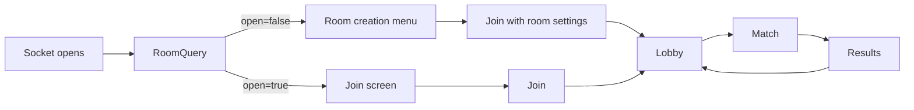

# Contract: Terminal and page

## Terminal options

| Command | New options |
|---------|-------------|
| `eksplode-re-cli host` | `--room-name <text>`, `--mode normal\|team\|chaser`, `--size small\|medium\|large`, `--time 2\|3\|5\|10`, `--friendly-fire on\|off`, `--no-setup` |
| `eksplode-re-cli` (local game, no subcommand) | `--mode`, `--size`, `--time`, `--friendly-fire` (no room name, no setup screen) |
| `eksplode-re-server` | the same five settings as start-up defaults of the creation menu |
| `eksplode-re-cli join` | none (the owner decides) |

Invalid values give a usage error that lists the allowed values (exit code 2). `--help` and `docs/` list them.

## Terminal setup screen (host)

Shown before the lobby unless a settings option or `--no-setup` is given.

```text
 ROOM SETUP
 > Name           Friday room
   Mode           < Team >      2 vs 2, 4 players
   Board size     < Medium >    19 x 15
   Round time     < 5 min >
   Friendly fire  < off >
   [ Create room ]
 Up/Down select   Left/Right change   Enter confirm   Esc back
```

Friendly fire is shown only for Team. The name accepts typed characters (limit 24). Enter on "Create room" opens the lobby. The pty check script (`scripts/pty-enter-check`) passes `--no-setup`.

## Terminal lobby and match

- Lobby: first line shows `name - Mode - size - time`; the owner changes settings with `M` (mode), `S` (size), `T` (time), `F` (friendly fire); others see them read-only.
- HUD: team letters `A`/`B` next to names in Team; the chaser marked `*` with hearts `<3 x2` and shield `[]`; the clock counts down and turns to "closing" at the pattern start.
- Board: announced squares `!!`; landed blocks as walls.
- Results: headline of the results table in `modes-and-rules.md`.
- Too-small terminal: the existing message includes the needed size of the chosen board.

## Page: flow



- No answer within 1 second: the old join screen (old host).
- Creation menu (`#room-panel`): name, mode cards (Normal, Team, Chaser with one-line rules), size and time selectors, friendly-fire switch (Team), "Create room" button; keyboard accessible, usable on a phone; defaults from the last use or from `RoomInfo.settings`.
- Lobby: a summary line for everybody; the owner sees the same controls and every change sends `SetRoom`; Team shows teams A/B per slot; Chaser shows that roles are drawn at the start.
- HUD: countdown, team colours on cards, hearts and shield on the chaser's card, "The walls close in!" banner at the pattern start, "Chaser" and "Runner" labels.
- Results: headline and details of the results table.
- The page CSP stays (no inline script); the new menu lives in `app.js` and `look.js`-style modules (`room.js` for the pure model: validation, labels, `SetRoom` payload).

## Page sounds

| Sound | Trigger |
|-------|---------|
| `warning` | pattern start and each announced square (soft tick, rate limited to one per 250 ms) |
| `impact` | block landing (low thud; louder when it crushes a player) |
| `heart` | chaser loses a heart |
| `win_team` | team win (reuses the win fanfare with a second voice) |

All generated in `audio.js` (no files); documented in `docs/AUDIO.md` (the docs test checks every sound is listed); respects mute and volume.

## Docs

`docs/GAMEPLAY.md` (new: modes, pattern, roles), `docs/WEB.md` (menu, lobby), `docs/PROTOCOL.md` (new messages and fields), README (options, modes). The docs tests check that every option, message and sound above is mentioned.

## Tests

`f4_us1_*` for menu and lobby model (node and cli key tests), option parsing tests, setup screen key tests, fit tests for the three sizes, smoke screenshots of the menu, lobby per mode, closing pattern, Team and Chaser.
