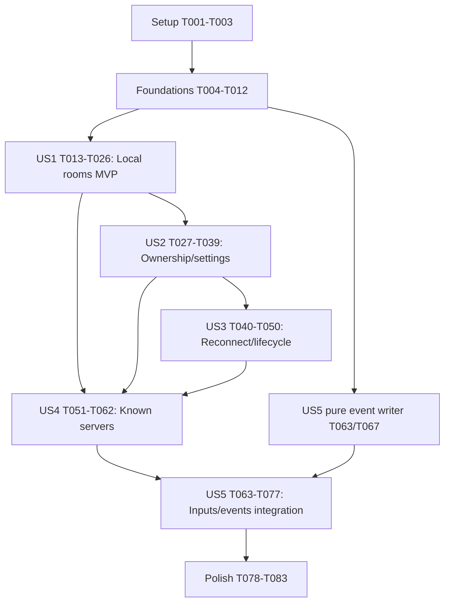

# Tasks: Multi-Room Servers and Discovery

**Input**: Design documents from `specs/008-multi-room-servers/`.

**Prerequisites**: [plan.md](plan.md), [spec.md](spec.md), [research.md](research.md), [data-model.md](data-model.md), [room protocol](contracts/room-protocol.md), [operations/navigation](contracts/operations-and-navigation.md), [quickstart.md](quickstart.md).

**Tests**: Required by Constitution II and the approved plan. Write each behavior's tests first, observe the intended failure, implement, then rerun the same focused check. Tests listed in a phase precede its implementation tasks. An implementation task is not complete until its tests pass. No runtime work or test execution is implied by these unchecked tasks.

**Organization**: Five independently verifiable user-story increments, following shared foundations. The final feature requires all five; US1 is an internal MVP, not a claim that the full specification is delivered.

## Format: `[ID] [P?] [Story] Description`

- `[P]` means the task can run beside the other explicitly identified tasks in its phase once their common prerequisites are complete; it does not waive dependencies or the test-first gate.
- `[US1]` through `[US5]` map to spec stories. Setup, foundations and polish have no story label.
- All paths below are repository-relative. New `discovery.rs` and `events.rs` are the two net modules proposed in the plan; reuse existing test files and helpers elsewhere.

## Path Conventions

Rust workspace: `game/`; authoritative networking: `game/crates/net/`; terminal: `game/crates/cli/`; web service/assets: `game/crates/web/`; existing browser smoke: `game/scripts/browser-smoke.mjs`. Keep network identity, secrets and clocks out of `game/crates/core/src/room.rs` and gameplay decisions out of JavaScript.

## Phase 1: Setup (Shared Infrastructure)

**Purpose**: Establish dependencies, known baselines and reusable test fixtures without scaffolding a new project.

- [X] T001 Confirm workspace MSRV and add only `getrandom` 0.2, `argon2` 0.5 and `subtle` 2 to `game/crates/net/Cargo.toml`; update `game/Cargo.lock`, verify the chosen releases on the declared toolchain, and retain the standard thread/channel architecture from research R1/R3.
- [X] T002 Record existing focused Rust/Node baseline results using the commands in `specs/008-multi-room-servers/quickstart.md`; distinguish pre-existing failures from changes, and leave all feature acceptance results pending.
- [X] T003 Extend `game/crates/net/tests/common/mod.rs` and `game/crates/web/tests/common/mod.rs` with explicit v2 handshake/create/join helpers, injectable fake service time/credential/event fixtures, bounded waiting and multiple-room session fixtures; ensure tests can demonstrate unsupported behavior before adding runtime features.

**Checkpoint**: Dependencies are justified, baseline is recorded and reusable tests do not require real 60-second waits.

## Phase 2: Foundational (Blocking Prerequisites)

**Purpose**: Establish shared wire types, private identities, safe transport and bounded coordinator infrastructure. No story starts before T012 passes.

### Tests First

- [X] T004 [P] Add failing v2 contract/codec tests in `game/crates/net/tests/codec.rs` for all request/reply variants, private-only proof fields, typed errors, room references, Hello timeout, legacy `Rejected{BadVersion}`, unknown enums, malformed input, the "65,536 bytes" frame limit and "a client-generated printable ASCII identifier of 1-64 characters" for request IDs.
- [X] T005 [P] Add failing shared-identity/seam tests in `game/crates/net/tests/room.rs` for OS-random IDs, randomness failure, monotonic service time, redacted credential wrappers, revision/counter bounds and no network fields added to core settings; quote and assert "server_epoch: random 128-bit launch identity" and "rooms: map of random 128-bit room_id to RoomRuntime, never derived from room name" from the data model.
- [X] T006 [P] Add failing configuration/bridge tests in `game/crates/web/tests/args.rs` and `game/crates/web/tests/websocket.rs` for validated server identity, room/connection limits, exit-code-2 configuration errors, preserved peer identity/origin checks and connecting outside a room without implicit Join.

### Implementation

- [X] T007 Implement protocol-v2 types, safe errors and negotiation in `game/crates/net/src/protocol.rs`, `game/crates/net/src/codec.rs` and `game/crates/net/src/host.rs`; retain tagged JSON framing, use two-second Hello timeout, echo control request IDs, return pending status for duplicate pending admissions without another mutation and allow one pending admission/connection; reject unsupported Hello versions now and retire legacy Join in T022 after the approved client cutover (FR-019).
- [X] T008 Add net-owned registry/membership primitives and injected service-clock/random-source seams in `game/crates/net/src/room.rs` and `game/crates/net/src/host.rs`; preserve "owner_membership_id: explicit optional owner", "Random membership_id, stable within the room; slot in 0-3", "status: connected | reserved", "connection_id only while connected" and "rejoin_proof: private 32 random bytes, wire-encoded as 64 lowercase hex characters, wrapped to prevent debug serialization"; use OS randomness and constant-time proof comparison, not seeded game RNG (T005).
- [X] T009 Provide shared unjoined transport/Hello handling in `game/crates/net/src/client.rs`, `game/crates/net/src/host.rs` and `game/crates/web/src/ws.rs`; preserve v2 request identity, expose only implemented capabilities and provide upgrade-required handling without silent fallback admission. Existing first-party client cutover and legacy retirement are explicitly deferred to T022-T024 by user approval; do not break current play before room selection exists (T004/T006).
- [X] T010 Establish the injectable typed significant-event sink and safe no-op/test sinks in proposed `game/crates/net/src/events.rs` and register it in `game/crates/net/src/lib.rs`; define schema-version-1 fields, optional room/actor/revision/tick, UTC epoch milliseconds and event sequence without printing or blocking the coordinator; the stdout writer and complete emissions are US5 work.
- [X] T011 Bound ingress/egress and coordinator dispatch in `game/crates/net/src/host.rs` and `game/crates/web/src/ws.rs`: 20 control requests/second with burst 40, Input ceiling 60/second, 128 queued commands/connection and at most 256 dispatched commands before rechecking due ticks; rotate room scheduling and drop slow/abusive connections instead of accumulating unbounded snapshots; extend T004/T006 tests before each implementation change.
- [X] T012 Wire validated identity/limits through `game/crates/net/src/host.rs`, `game/crates/web/src/options.rs`, `game/crates/web/src/args.rs`, `game/crates/web/src/lib.rs` and `game/crates/cli/src/args.rs`: "server_id: operator-configured ASCII identifier, 1-64 characters [A-Za-z0-9._-]", "max rooms (default 32, range 1-128), max connections (default 256)", configurable connections 4-1024, web cap no greater than host cap; rerun T004-T006 and compile all affected callers.

**Checkpoint**: Shared wire/configuration/seams pass focused tests; v2 connections do not implicitly enroll, transport queues are bounded and secrets are not publicly serialized. Fake clock and event sink are usable by every story. The existing legacy client path remains temporarily available until T022-T024 complete.

**Execution note (2026-10-28)**: The user approved moving the all-caller cutover into T022-T024. T001-T012 now pass their foundation checks, including deterministic service injection, private admission ledgers, bounded queues, slow-reader/flood isolation and shared terminal/web limits. Existing first-party play temporarily uses the legacy path; v2 advertises only implemented capabilities and rejects unavailable operations explicitly. T009 covers shared unjoined transport only; client UI cutover and legacy retirement remain unfinished US1 work.

During this temporary compatibility period, bounded queues and control-request budgets apply to both transports; the 60-input/second ceiling applies immediately to v2. Legacy input cadence remains unchanged until T022 retires that path, preserving the existing accelerated simulation tests rather than weakening the final v2 limit.

## Phase 3: User Story 1 - Choose a Room and Play Independently (Priority: P1)

**Goal**: Explicitly create/list/join local rooms and run isolated simultaneous matches through both clients.

**Independent Test**: Three four-participant rooms (Normal, Team, Chaser) finish 20 rounds each with no cross-room gameplay disclosures or mutation; initial connection remains outside a room, a fresh join cannot enter an ongoing match, and 100 requests for one final seat admit exactly one.

### Tests First

- [X] T013 [P] [US1] Add failing create/list/join/routing tests in `game/crates/net/tests/room_host.rs` for AS-1.1 through AS-1.4, one-room membership, duplicate room names, server/room limit errors, invalid/cross-room requests and the 100-client final-seat race; test selecting another room never silently removes current membership.
- [X] T014 [P] [US1] Add failing simultaneous-mode isolation tests in `game/crates/web/tests/mixed.rs` using independent seeded rooms, mixed TCP/WebSocket players, per-room bots/looks/developer state and start/snapshot/result messages; include same-slot IDs in different rooms (AS-1.2).
- [X] T015 [P] [US1] Add failing initial-directory/create/select/join/error presentation tests in `game/crates/web/js-tests/app.test.mjs` and `game/crates/web/js-tests/room.test.mjs`; assert no automatic Join and preservation of configured gameplay controls and pending result views (AS-1.1/1.3/1.4).
- [X] T016 [P] [US1] Add failing terminal directory/create/join and explicit-host-initial-room tests in `game/crates/cli/tests/online.rs` and `game/crates/cli/tests/setup.rs`; local-only play and existing name/key options remain unchanged (AS-1.1).

### Implementation

- [X] T017 [US1] Extract isolated RoomRuntime state into `game/crates/net/src/room.rs` and `game/crates/net/src/host.rs`: "revision: u64 incremented on settings, phase, ownership or occupancy mutation", "settings: core::RoomSettings", "phase: lobby | running | closing", "Optional running: game state, seed, tick, pending inputs, bot controllers, results and next due tick"; retain per-room lobby, looks, ready and developer state, and explicit optional owner outside core (T013/T014).
- [X] T018 [US1] Implement atomic CreateRoom and creator ownership in `game/crates/net/src/host.rs`; assign unique host/epoch/room/membership references, default capacity four/no password, apply existing startup defaults and bots at most capacity minus one only after explicit creation, and guard start/bot actions by owner identity from the beginning (FR-001/003/018).
- [X] T019 [US1] Implement serialized fresh JoinRoom and LeaveRoom binding in `game/crates/net/src/host.rs`; validate epoch, lobby phase, capacity and current binding, return precise Full/InMatch/AlreadyInRoom errors without partial changes, never silently evict bots, and revoke/disconnect explicit departed members using the shared membership model (T013).
- [X] T020 [US1] Route all gameplay/lobby/developer actions and broadcasts by bound membership in `game/crates/net/src/host.rs`; maintain independent 20 Hz ticks/seeds/ordered inputs/bots/results, validate tick age per room, reject mismatched room IDs before dispatch and preserve unchanged core rules/powers/audio observations (T014; FR-004/018).
- [X] T021 [US1] Implement public local summaries/ListRooms in `game/crates/net/src/host.rs` and `game/crates/net/src/room.rs`: "Local summary fields: reference, name, mode, size, minutes, capacity, occupied, connected humans, reserved humans, bot count, phase, password-required, revision and host endpoint metadata from trusted configuration"; hide secrets, count takeover reservations once, paginate 32/page within 64 KiB, and expire source/epoch/revision-bound cursors after five seconds with one restart on invalidation (T013).
- [X] T022 [US1] Complete the approved first-party cutover from T009: adapt `HostHandle`/local-client/add-bot/start helpers in `game/crates/net/src/host.rs`, `game/crates/net/src/client.rs`, `game/crates/web/src/lib.rs` and `game/crates/cli/src/online.rs` to explicit room references and unjoined clients together with T023/T024; migrate existing room/loopback/lobby/dev integration callers, reject legacy Join safely once clients are ready, and remove temporary hidden first-room routing.
- [X] T023 [US1] Implement browser local directory, create/select/join and explicit leave confirmation in `game/crates/web/assets/app.js`, `game/crates/web/assets/room.js`, `game/crates/web/assets/index.html` and `game/crates/web/assets/style.css`; use existing navigation layers, meaningful focus and responsive controls from the first increment, not a mouse-only interim UI (T015).
- [X] T024 [US1] Implement terminal local directory, room creation/selection and explicit leave in `game/crates/cli/src/online.rs`, `game/crates/cli/src/setup.rs`, `game/crates/cli/src/lobby.rs` and `game/crates/cli/src/args.rs`; `join ADDR` opens the directory, optional `--room-id` selects explicitly, host mode creates its initial room after setup and custom keys/small-terminal warnings remain available (T016).
- [X] T025 [US1] Add read-only local `GET /rooms` and `GET /rooms?scope=local` using the host handle in `game/crates/web/src/http.rs` and `game/crates/web/tests/http.rs`; test first, then implement JSON/no-store responses, cursor/scope 400 errors and no player admission or relaxed WebSocket origins; known scope aggregates in US4.
- [X] T026 [US1] Execute T013-T016, existing net room/loopback/dev checks and 20 seeded rounds per mode; record isolated three-room results and exact AS-1.1-1.4 test names in `specs/008-multi-room-servers/quickstart.md`, leaving reconnect/remote/logging claims pending.

**Checkpoint**: Local multi-room MVP works in browser and terminal. Do not mark the complete feature delivered before US2-US5 and final gates.

**Current execution status (2026-10-28)**: T001-T026 are complete (26/83 tasks). Named rooms, trusted local source/endpoints and both first-party v2 interfaces are working, with a successful three-mode/60-round isolation workload and desktop/mobile browser checks. All admission fixtures now select/create explicitly; v1 Join is safely rejected, the default SDK connection is unjoined, and implicit local-client/unscoped host controls are removed. Constitution v1.2.0 and the centered responsive layout are preserved. All 727 Rust tests, formatting/all-target Clippy, Rust 1.75 net checks and 173 browser unit tests pass. Password admission, reconnect, known-server discovery and the stdout writer are not implemented and remain unchecked.
**Current execution status (2026-10-29, morning)**: T001-T026, T029 and T031 are complete (28/83 tasks). Local named rooms and safe v1 retirement remain green. Private Argon2id verification and the bounded two-worker/32-queue pool meet T031's validation, randomness and redaction criteria. Protected create/join and atomic owner password set/replace/clear work with stale-revision/active-match revalidation; T027/T032/T033 still need complete edge and reconciliation coverage. Browser masked password entry, capacity and owner password controls are implemented; terminal protected joins are masked/cancellable/retryable and owners can change capacity or set/remove protection. Owner removal, admission-timeout reconciliation UI, and terminal password creation remain open. Full Rust workspace (746 tests/77 suite reports), 175 browser tests, formatting, all-target Clippy and Rust 1.75 net checks pass. Reconnect, known-server discovery and stdout logging remain unchecked.
**Current execution status (2026-10-29, later)**: T001-T031, T034 and T038 are complete; T027/T028/T030/T039 close out as part of the same increment (33/83 tasks). `RemovePlayer` is implemented end to end (revocation, active-match bot takeover, fresh-rejoin after removal, `NotOwner`/`NotInRoom` rejection) with v2-level owner-permission coverage for `Start`/`AddBot`/`RemoveBot` that previously existed only at the legacy v1 protocol. The `CapacityConflict` boundary now has test coverage. A mixed TCP/WebSocket password-protection and atomic-settings test was added in `game/crates/web/tests/mixed.rs`. T035 is partial: bounded password-failure accounting (five/minute/source, 100/minute/host, 4,096-entry bounded table, pre-verification gating) is implemented and tested, but resume-failure accounting and web-bridge forwarded-header trust remain open, so T035 stays unchecked. T032/T033/T036/T037 are unchanged from the prior checkpoint and remain open: admission-reconciliation edge coverage, full browser owner-removal/timeout-reconciliation UI, and terminal password-creation/removal UI are not yet done. Full Rust workspace (754 tests/77 suite reports), 175 browser tests, formatting, all-target Clippy and Rust 1.75 net checks pass. No commits or branches were created. Reconnect, known-server discovery and stdout logging remain unchecked (US3-US5).
**Current execution status (2026-10-29, evening)**: Added T063/T067/T069 from Phase 7 (US5 diagnostic events/stdout logging), plus substantial partial progress on T068 (36/83 tasks complete; 34 if T068 and the T063-adjacent core-Event-classification gap are counted separately — see the Phase 7 notes above for the precise split). The bounded JSONL event writer (`game/crates/net/src/events.rs`) is fully implemented and unit-tested (saturation, recoverable failure, bounded shutdown, zero loss, allow-listed redaction). Real mutation points in `host.rs` now emit correlated typed events for room creation/join/leave/disconnect/removal/ownership-transfer/closure/settings-change/match-start/match-end/permission-denial/protocol-rejection, verified both by a new net integration test and by running the actual compiled `eksplode-re-server` binary and confirming stdout is pure parseable JSONL while the banner lands on stderr. The CLI host path avoids corrupting its own TUI by using a no-op sink whenever stdout is a real terminal, switching to the real writer only when stdout is redirected. Not done in this slice: discovery/resume events (blocked on US3/US4 not existing yet), per-gameplay-event classification (eliminations/power-ups/bomb explosions), and the navigation/input/touch portions of US5 (T064-T066, T070-T072, T075, T077) which are a separate sub-area from diagnostic events and were not touched. Full Rust workspace (760 tests/77 suite reports), 175 browser tests, `cargo fmt --check`, `cargo clippy --all-targets -- -D warnings` and `cargo test --workspace` all pass.
**Current execution status (2026-10-29, night)**: Audited T032 against the actual `game/crates/net/src/{host,protocol,room,client}.rs` code rather than assuming the prior unchecked box was accurate, since the password-worker/Argon2id work landed under T031 already carried most of this task's scope. Confirmed line-by-line that every clause is implemented and covered by passing tests: `AdmissionLedger` (`room.rs`) enforces the five-second monotonic deadline from `begin()` including queue wait (`queue_password` reads the original `pending_deadline`, not a fresh one), serializes cancel-vs-commit (`complete_password` discards a late worker result once `admissions.status` has left `Pending`, e.g. after `CancelRequest`), retains eight terminal results per connection for 60 seconds with `Busy` returned on exhaustion rather than evicting an unexpired entry, and treats a vanished connection (`self.conns.get_mut(&id)` failing) as a live-requester check that silently drops commit. `join_candidate`/`settings_candidate` fully re-validate current room existence, `expected_revision`/`StaleRevision`, phase/capacity (`admission_candidate`/`admit`) and owner identity at completion time, not against state captured when the job was queued. `RequestStatus`/`CancelRequest` (`host.rs:1326-1361`) are connection-scoped (a different connection querying another's `target_request_id` gets `unknown`, never the private result) and return `RequestState::{Pending,Committed,Rejected,Cancelled,Expired,Unknown}` exactly per contract. This is exercised by `protected_room_admission_verifies_passwords_without_public_secrets`, `protected_room_final_seat_is_committed_once_after_concurrent_verification`, `owner_password_updates_are_atomic_omission_preserves_and_empty_removes_protection` and the codec-level `RequestStatus`/`CancelRequest` cases, all green. T032 is marked complete on this evidence. The same pass also audited T033 (`room.rs:1087-1135`, the `SetRoom` arm of `RoomRuntime::command`): it rejects non-lobby phase (`InMatch`) before any mutation, validates `expected_revision` (`StaleRevision`), rejects a capacity drop below current participants (`CapacityConflict`), validates/trims the name, routes a non-empty password to the async Argon2id path (`Unsupported` here, handled by `queue_password`/`complete_password` in `host.rs`) while an explicit empty password clears protection synchronously, and finishes with `Ok(self.fanout(self.updated()))` so every member receives a consistent public `RoomUpdated`; rematch retention and membership preservation across a password-only change were already covered by existing lobby/rematch tests. T033 is marked complete on the same evidence. Ran `cargo fmt --check`, `cargo clippy --all-targets -- -D warnings` and `cargo test --workspace` (unchanged pass counts, no new failures) to confirm the checkbox flips introduce no regression. T035-T037 remain genuinely open as previously recorded. No commits or branches were created.

## Phase 4: User Story 2 - Own and Manage a Room (Priority: P1)

**Goal**: Owner-only validated settings, password admission, removal and deterministic ownership transfer after explicit departure.

**Independent Test**: Create a capacity-two protected room, compare owner/member actions, change valid/invalid settings, remove a participant and explicitly leave as owner; verify safe rejection, revocation and transfer to the longest-present connected human. Expiry-triggered transfer is verified with US3.

### Tests First

- [X] T027 [P] [US2] Add failing owner/settings/password/race tests in `game/crates/net/tests/room_host.rs` for AS-2.1-2.6, all name/password/capacity boundaries from data-model.md, full-config atomicity, password-only revision invalidation, async completion after leave/start/change/closure/deadline/cancellation, duplicate pending/completed retries, lost committed replies, result-cache exhaustion and no secret in public summaries or errors; assert timed-out outcomes are reconciled rather than blindly resubmitted.
- [X] T028 [P] [US2] Add failing owner-only Start/AddBot/RemoveBot/developer permissions and takeover/removal tests in `game/crates/net/tests/lobby.rs` and `game/crates/net/tests/dev.rs`; members retain own ready/look/gameplay/leave, capacity includes bots/reservations once and mode-specific start requirements remain authoritative.
- [X] T029 [P] [US2] Add failing capacity/password/authoritative-owner controls in `game/crates/web/js-tests/lobby.test.mjs` and `game/crates/cli/tests/online.rs`; cover masked entry, owner-change rendering, nonowner rejection and control enablement by phase instead of first-human-slot inference.

### Implementation

- [X] T030 [US2] Implement admission/settings validation in `game/crates/net/src/room.rs`: "Names: 1-24 printable characters after trim (empty creation name defaults to creator's name plus room suffix, truncated to 24); control characters rejected", "Capacity is 1-4; Team and Chaser require capacity four and four participants at start", and "Capacity cannot drop below occupied slots"; existing mode/board/time options stay unchanged (T027).
- [X] T031 [US2] Add private Argon2id verifier creation/verification in `game/crates/net/src/room.rs` with two bounded workers/32 queued jobs, 19 MiB/two passes/one lane; enforce "Password is 1-128 Unicode scalar values, at most 512 UTF-8 bytes, with control characters rejected; empty password on explicit update removes protection"; omitted password keeps verifier, and plaintext/verifier/salt never enters core settings, public wire state or Debug output (T027).
- [X] T032 [US2] Integrate password worker completion and admission reconciliation into `game/crates/net/src/host.rs`, `game/crates/net/src/protocol.rs` and `game/crates/net/src/client.rs`; enforce the "five-second monotonic deadline" including queue time, cancellation/live-requester checks and current room/password revision/phase/capacity/reservation before commit; implement RequestStatus/CancelRequest, serialize cancel-vs-commit, and retain private terminal outcomes for "60 seconds" in "eight reserved result slots per connection"; duplicate requests never mutate twice, unknown status never authorizes blind retry, and exhaustion returns Busy before accepting work (T027).
- [X] T033 [US2] Implement full-config SetRoom and private proof/password-aware admission in `game/crates/net/src/host.rs`; enforce owner plus expected_revision, reject all active-match settings changes, broadcast consistent public changes and retain settings for rematch; password changes affect fresh joins, not existing memberships or reserved returns (T027).
- [X] T034 [US2] Implement owner-only removal and explicit-departure transfer in `game/crates/net/src/host.rs`: revoke entitlement immediately, retain active-match state under a bot, choose "connected human with smallest join sequence, then slot as tie-breaker", never grant bots administration and never remove another room's member; removal is not a permanent ban (T027/T028).
- [ ] T035 [US2] Implement bounded abuse accounting in `game/crates/net/src/host.rs` and preserve peer identity in `game/crates/web/src/ws.rs`: five password/resume failures/minute/source, aggregate 100/minute/host, 4,096 expiring/LRU entries; default to socket peer and trust forwarded headers only under explicit proxy trust; write focused spoofing/saturation tests before changing this path. Partial (2026-10-29): `FailureAccounting` (`game/crates/net/src/room.rs`) implements and tests the five/minute/source and 100/minute/host bounds plus the 4,096-entry bounded table with oldest-source eviction, gated *before* verification so a correct password is also refused during lockout; wired into the `JoinRoom` password path in `host.rs`. Not done: resume-failure accounting (no `ResumeRoom` yet; US3/T045) and trusted-forwarded-header support in `web/src/ws.rs` (still keys on the raw socket peer only).
- [ ] T036 [US2] Implement browser capacity/protected-room setup, masked password prompt, owner removal and explicit authoritative-owner rendering in `game/crates/web/assets/room.js`, `game/crates/web/assets/app.js` and `game/crates/web/assets/index.html`; show outcome unknown on admission timeout, retain the original request ID and reconcile/cancel before a fresh admission, writing focused JS tests first; do not store passwords in room defaults/localStorage, keep form/native/onscreen-keyboard focus behavior and clear ephemeral password state on cancel/submit (T029).
- [ ] T037 [US2] Implement matching owner settings, bot controls, masked interactive passwords and removal in `game/crates/cli/src/setup.rs`, `game/crates/cli/src/lobby.rs` and `game/crates/cli/src/online.rs`; add first-failing terminal tests for timeout-as-unknown and original-ID status/cancellation reconciliation before fresh admission; never accept passwords in argv, and preserve local nonnetwork setup rules/custom keys (T029).
- [X] T038 [US2] Add failing-then-passing mixed TCP/WebSocket protection and atomic settings integration cases in `game/crates/web/tests/room.rs` (landed in `game/crates/web/tests/mixed.rs`, which already holds this feature's mixed TCP/WebSocket fixtures); verify public RoomUpdated owner/capacity/password-required fields, no private broadcasts and unchanged state on rejected changes.
- [X] T039 [US2] Run the focused T027-T029/T038 suites and record exact AS-2.1-2.6 test links/results in `specs/008-multi-room-servers/quickstart.md`; record AS-2.6 expiry-transfer completion as dependent on T044/T050 rather than pretending reconnect already works.

**Checkpoint**: Passwords and owner permissions work locally in both clients; temporary-owner absence and expiry are the next increment.

## Phase 5: User Story 3 - Recover from a Lost Connection (Priority: P2)

**Goal**: Secure recovery of the same participant within 60 seconds, with reservation-aware ownership and room cleanup.

**Independent Test**: Twenty fake-clock scenarios cover valid, expired, revoked, forged and concurrent returns, preserve current eliminated/role/team state, and guarantee at most one controller. Last-human disconnect retains the room until the final deadline; explicit last-human leave without reservations closes immediately.

### Tests First

- [ ] T040 [P] [US3] Add 20 failing fake-clock membership/owner cases in `game/crates/net/tests/loopback.rs` for AS-3.1-3.4 and AS-2.6: transport/silence loss, exact deadline, forgery/name impersonation, lost Resumed/AckResume/ResumeAcknowledged, same-operation replay cutoff/old-proof revocation, concurrent reclaim, last-human loss, A-disconnects/B-explicitly-leaves with A's original reservation preserved, vacant owner, elimination, rematch, removal/leave and restart/old-epoch invalidation; assert one rotation/controller and no reservation extension by retries, with no real waits for expiry.
- [ ] T041 [P] [US3] Add failing WebSocket disconnect/reload/rejoin/closure tests in `game/crates/web/tests/lifecycle.rs` and `game/crates/web/tests/websocket.rs`, including late old-connection input and a delayed worker completion after room cleanup.
- [ ] T042 [P] [US3] Add failing proof-storage/retry/expiry UI tests in `game/crates/web/js-tests/app.test.mjs` and `game/crates/cli/tests/online.rs`; web uses origin-scoped sessionStorage with unavailable-storage fallback, CLI memory only; retain the pending resume request ID, store replacement proof before AckResume, and retry lost reply/ack with the same operation rather than a fresh rotation or silent fresh admission.

### Implementation

- [ ] T043 [US3] Implement connected-to-reserved transitions and slot-preserving bot takeover in `game/crates/net/src/host.rs`: "reserved_until: monotonic deadline only while reserved; exactly 60 seconds after detected disconnection, not the last received input", "lobby ready becomes false", and "a temporary takeover bot and its human reservation are the same occupied slot"; hold the owner entitlement through absence (T040/T041).
- [ ] T044 [US3] Implement deadline expiry and owner reassignment in `game/crates/net/src/host.rs`: "At now >= reserved_until, revoke proof and release lobby seat or retain an ordinary bot in a running match"; expired proof never reclaims that bot; if no connected humans but valid reservations remain, owner is vacant and "the earliest eligible returning human becomes owner" without displacing an already transferred owner (T040).
- [ ] T045 [US3] Issue private proofs on Welcome and implement ResumeRoom/Resumed/AckResume/ResumeAcknowledged in `game/crates/net/src/host.rs`, `game/crates/net/src/client.rs` and `game/crates/net/src/protocol.rs`; add the data-model pending_rotation fields with "ten seconds" same-operation replay capped by "the original reservation deadline" and acknowledgment. Constant-time validate the same membership/epoch, prepare one replacement proof, replay it without another rotation, revoke the previous proof on AckResume/cutoff and keep acknowledgments idempotent. Rebind a new connection only after prior disconnect, discard retired input, preserve the pre-ack original deadline, and revoke both proofs/replay state on leave/removal/expiry/closure; restore current state without rewind/revival (T040/T041).
- [ ] T046 [US3] Complete room closing/revocation in `game/crates/net/src/host.rs`: "Closing revokes credentials, clears pending inputs, shuts down room-specific work, publishes removal and unbinds members"; close only when no connected humans or valid reservations remain. Explicitly preserve A's reservation when B is the last connected human and leaves; revoke only B's entitlement, and close when A's original deadline expires. Handle removal/shutdown, invalidate both proof generations/replay state and delayed results for removed rooms/old epochs, and release bots/queues/cursors (T040/T041).
- [ ] T047 [US3] Implement browser origin/room-scoped sessionStorage proofs and reconnect window/retry/expiry/closed feedback in `game/crates/web/assets/app.js`; retain pending resume request ID for reload recovery, store the replacement proof before AckResume, and retry lost replies/acknowledgments under the same bounded operation without extending its deadline. Clear both proof generations/recovery metadata on LeaveRoom/Removed/RoomClosed, warn gracefully on unavailable storage, clear held inputs/stale dialogs and never put proofs in URLs/default storage/logs (T042).
- [ ] T048 [US3] Implement in-memory terminal reconnect/retry/return-to-directory in `game/crates/cli/src/online.rs` and `game/crates/cli/src/lobby.rs`; store replacement proof before acknowledgment, preserve pending resume request ID and safely retry lost reply/ack using the same operation; retain current identity/custom keys, discard all proof/replay metadata on explicit revocation/process exit and display precise failure without autojoining another room (T042).
- [ ] T049 [US3] Add failing-then-passing 100-cycle create/play/close resource regression tests in `game/crates/net/tests/room_host.rs` and `game/crates/web/tests/lifecycle.rs`; assert directory/membership/reservation/worker bindings return to baseline and no joinable ghost rooms remain (SC-006).
- [ ] T050 [US3] Run T040-T042/T049 plus owner-transfer tests and record all 20 reconnect outcomes, AS-3.1-3.4 and completed AS-2.6 results in `specs/008-multi-room-servers/quickstart.md`; verify current eliminated state and one-controller invariants explicitly.

**Checkpoint**: Secure reconnect, ownership reservation/transfer and room lifecycle work without shared-room side effects.

## Phase 6: User Story 4 - Discover and Join Known Servers (Priority: P2)

**Goal**: Aggregate configured hosts safely and connect to the selected destination, without recursive federation or split match authority.

**Independent Test**: Two configured servers publish identically named rooms; both remain distinct and eligible remote rooms join through their own host. Host loss/incompatibility leaves local play usable, marks stale/unavailable status and never admits against cached data.

### Tests First

- [ ] T051 [P] [US4] Add failing local-only/known directory worker tests in `game/crates/net/tests/room_host.rs` and `game/crates/net/tests/codec.rs` for AS-4.1-4.3: identity mismatch, no recursive fetch/redirects, whole-attempt timeout, oversized/invalid counts, paginated cursor invalidation, stale TTL and source health events. Fake-clock tests separately assert healthy-directory availability and failure-detection interval + fair queue + timeout budgets, including maximum 16-source saturation.
- [ ] T052 [P] [US4] Add failing known-server option/HTTP directory tests in `game/crates/web/tests/args.rs`, `game/crates/web/tests/http.rs` and `game/crates/web/tests/origin.rs`; reject malformed/duplicate IDs, unsafe origins, player-provided fetch destinations and CORS/origin relaxation.
- [ ] T053 [P] [US4] Add failing browser/terminal handoff tests in `game/crates/web/js-tests/room.test.mjs` and `game/crates/cli/tests/join_errors.rs`; selection preserves membership, explicit acknowledged Leave precedes switch, destination failure offers retry/selection, URL carries identity only and HTTPS cannot downgrade to HTTP.

### Implementation

- [ ] T054 [US4] Parse and validate known hosts in `game/crates/net/src/room.rs`, `game/crates/web/src/args.rs`, `game/crates/web/src/options.rs` and `game/crates/cli/src/args.rs`: "known_servers: at most 16 configured {server_id, label, game_addr, web_origin} records; unique IDs, no credentials or URL paths/query/fragment in origin"; use repeatable `--known-server ID,GAME_ADDR,WEB_ORIGIN`, reject commas/userinfo, support bracketed IPv6 game endpoints and carry into integrated/terminal hosting (T052).
- [ ] T055 [US4] Implement bounded peer directory workers in proposed `game/crates/net/src/discovery.rs` and register it in `game/crates/net/src/lib.rs`: "Poll every five seconds, timeout two seconds, concurrency four. Local directory requests never recursively fetch peers"; apply two seconds to the complete handshake/pages/cursor-restart attempt, allow one queued/in-flight poll per source and schedule oldest due fairly. Enforce failure-detection budget five seconds + queue wait + two seconds (seven seconds in the guide, at most 13 seconds with 16 sources), separately from healthy cached/local availability; fetch at most four pages/128 rooms through v2 TCP without coordinator-blocking work (T051).
- [ ] T056 [US4] Implement validated source cache/summary merging in `game/crates/net/src/discovery.rs`: status "fresh | stale | unavailable | incompatible", expected identity/epoch/version/capabilities and success/attempt ages; "At failed refresh, mark last summaries stale immediately; remove stale summaries after 15 seconds without success, retaining source status for explanation"; "Peer-advertised origins/addresses never override configured host destinations" (T051).
- [ ] T057 [US4] Expose aggregate/local-only paginated directory via `game/crates/net/src/host.rs`, `game/crates/web/src/http.rs` and `game/crates/web/src/lib.rs`; known requests read cache without blocking or creating membership, preserve room host/epoch identity, reject unsupported scope/cursor safely and keep existing same-origin WebSocket protections (T051/T052).
- [ ] T058 [US4] Implement browser host/source/status listing and remote handoff in `game/crates/web/assets/room.js` and `game/crates/web/assets/app.js`; distinguish duplicate names, navigate only to configured origin with escaped server/epoch/room fragment, clean the destination fragment after selection, recollect credentials locally, confirm/acknowledge leave before switching and reject HTTPS-to-HTTP downgrade (T053).
- [ ] T059 [US4] Implement terminal known-source directory and destination connection in `game/crates/cli/src/online.rs` and `game/crates/cli/src/setup.rs`; use configured game address, negotiate again, revalidate destination admission and preserve source membership during browsing but not promise atomic rollback after acknowledged leave (T053).
- [ ] T060 [US4] Add failing-then-passing two-host mixed integration in `game/crates/web/tests/mixed.rs` and `game/crates/cli/tests/online.rs`; cover same-name hosts, remote password/capacity/phase races, source still usable on peer loss and no wrong-room or secret transfer (AS-4.1-4.3).
- [ ] T061 [US4] Verify bounded cancellation and shutdown of workers in `game/crates/net/src/discovery.rs` and `game/crates/net/src/host.rs` with first-written tests in `game/crates/web/tests/lifecycle.rs`; unavailable sources, stale pages, shutdown and deleted rooms cannot retain threads/jobs indefinitely or block healthy directory/play beyond five seconds.
- [ ] T062 [US4] Run T051-T053/T060-T061 and the documented alpha/beta setup; record healthy-directory availability within five seconds separately from failed-source detection against poll interval + measured queue wait + whole-attempt timeout (seven-second guide budget; 13 seconds at 16 sources), plus destination authority, duplicate-name distinction and AS-4.1-4.3 results in `specs/008-multi-room-servers/quickstart.md`.

**Checkpoint**: Rooms are discoverable/joinable across known hosts; one room still has exactly one authoritative host.

## Phase 7: User Story 5 - Navigate Consistently and Diagnose Events (Priority: P2)

**Goal**: Verify every new flow with established inputs and emit significant, correlated, secret-free stdout records.

**Independent Test**: Complete list/create/password/join/manage/leave/rejoin/handoff flows using keyboard, browser controller, mobile touch and terminal controls; exercise every significant event category, parse stdout, and assert no canary secret appears and blocked output never stalls matches.

### Tests First

- [X] T063 [P] [US5] Add failing schema/category/redaction/queue tests in proposed `game/crates/net/src/events.rs` under its unit-test module using injected sinks; require optional room/actor/revision/tick, UTC timestamp, monotonic sequence, safe fields, every lifecycle/permission/match/discovery category and every core Event variant classification. Separately test saturation and recoverable writer failure, exact undelivered-record counting/reporting after recovery, and zero drops under normal load; malformed secret-bearing input must never be logged raw (AS-5.2/5.3). Writer-mechanics coverage (schema, allow-listed redaction, saturation, recoverable failure, bounded shutdown, zero loss) is complete; classifying every core gameplay `Event` variant is not implemented (tracked under T068).
- [ ] T064 [P] [US5] Add failing keyboard/controller/password-layer tests in `game/crates/web/js-tests/nav-focus.test.mjs`, `game/crates/web/js-tests/nav-input.test.mjs`, `game/crates/web/js-tests/nav-layers.test.mjs` and `game/crates/web/js-tests/osk.test.mjs`; cover list refresh selection, opener restoration, held-button release and no gameplay while typing for all new room contexts (AS-5.1).
- [ ] T065 [P] [US5] Add failing responsive touch/results regressions in `game/crates/web/js-tests/touch.test.mjs` and `game/crates/web/js-tests/input.test.mjs`; retain portrait bottom-corner controls, landscape layout, conditional Punch, multi-touch and cancellation/blur/orientation clearing, plus usable masked native password entry at 360x640 and 844x390 (AS-5.1).
- [ ] T066 [P] [US5] Add failing terminal-host stdout/TUI/secret-entry and reconnect control checks in `game/crates/cli/tests/pty.rs`, `game/crates/cli/tests/keys.rs` and `game/crates/cli/tests/session.rs`; preserve custom keys and small-terminal handling and prevent diagnostic/log text from corrupting the rendered TUI (AS-5.1-5.3).

### Implementation

- [X] T067 [US5] Implement schema-version-1 JSONL writer in `game/crates/net/src/events.rs`: bounded 4,096-record queue, nonblocking enqueue, zero loss under normal three-room load, and exact accumulated undelivered-record count including overflow, failed writes and unhealthy-sink discards. Count uncertain-delivery writes conservatively as lost, report logging.records_dropped when output recovers, warn once to stderr on failure, retain unhealthy status and cap shutdown drain at two seconds with remaining-count diagnostic; never block gameplay or wait indefinitely on a stuck writer (T063).
- [ ] T068 [US5] Emit typed events at accepted mutation/rejection decisions in `game/crates/net/src/host.rs` and `game/crates/net/src/discovery.rs`; cover all categories from contracts/operations-and-navigation.md, correlate host/epoch/room/member/revision/tick and classify every existing core Event explicitly, excluding routine movement/repeated animation/snapshots; discovery reports health transitions and repeated failure summaries at most once/source/minute (T063). Partial (2026-10-29): wired in `host.rs` at real mutation points, correlated by room_id/actor (membership_id)/room_revision — `RoomCreated`/`PlayerJoined`/`PlayerJoinRejected` (admission commit), `PlayerLeft`/`PlayerDisconnected`/`RoomOwnerChanged`/`RoomClosed` (`detach_room`, explicit vs. disconnect distinguished), `PlayerRemoved` (+`RoomOwnerChanged` if removal changes owner), `RoomSettingsChanged` (both the plain and password-bearing `SetRoom` paths), `MatchStarted`, `MatchEnded` (phase-transition detection in the room-advance loop), `PermissionDenied` (`NotOwner`, centralized in `send_room_error`), `RequestRateLimited` (pre-existing) and `ProtocolRejected` (all three BadVersion rejection points). Verified end to end against the real `eksplode-re-server` binary: stdout carries only valid JSONL, stderr carries the banner. Not done: `tick` correlation (left `None` throughout — no wired event currently needs mid-match tick correlation since per-tick gameplay is explicitly excluded), discovery health events (`discovery.rs` doesn't exist until US4), `PlayerResumed`/`PlayerResumeRejected`/`PlayerReservationExpired` (no `ResumeRoom` until US3), and classifying individual core gameplay `Event` variants (eliminations, power-ups, bomb explosions) into significant-event categories.
- [X] T069 [US5] Route server banners/diagnostics to stderr and keep stdout JSONL-only in `game/crates/web/src/main.rs`, `game/crates/web/src/lib.rs`, `game/crates/cli/src/main.rs` and `game/crates/cli/src/online.rs`; keep TUI output independent of JSON stdout, test both terminal and redirected-pipe cases, and preserve machine-readable records without human banner interleaving (T066). `online.rs` has no stdout banners to move. The CLI host mode gates the event writer on `stdout().is_terminal()`: a real terminal (active TUI) gets a no-op sink, a redirected/piped stdout gets the real JSONL writer; `--help`/`--version` stay on stdout by CLI convention since no server or writer runs in that branch.
- [ ] T070 [US5] Integrate complete navigation contexts into `game/crates/web/assets/nav.js`, `game/crates/web/assets/controls.js` and `game/crates/web/assets/app.js`; retain Tab/Shift+Tab, native selects, Enter/Space, Escape-top-layer-only, selected-controller D-pad/stick/A/B/Start, masked on-screen keyboard target and release-before-activation on context changes; labels/telemetry never reveal passwords (T064).
- [ ] T071 [US5] Complete responsive room/password/reconnect/handoff presentation in `game/crates/web/assets/index.html`, `game/crates/web/assets/style.css` and `game/crates/web/assets/app.js`; usable directory/forms at 360x640 and 844x390, visible owner/source/error/focus, native password entry, useful focus after closure/removal and stable list identity during refresh; retain match controls, conditional Punch and results until explicit Return to Lobby (T065).
- [ ] T072 [US5] Close remaining terminal input/owner/reconnect/leave-confirmation gaps in `game/crates/cli/src/setup.rs`, `game/crates/cli/src/lobby.rs` and `game/crates/cli/src/online.rs`; satisfy T066 without adding unsupported terminal controller/touch behavior or changing custom gameplay bindings.
- [ ] T073 [US5] Add failing-then-passing canary-secret end-to-end checks in `game/crates/web/tests/fuzz.rs` and `game/crates/web/tests/lifecycle.rs`; inspect stdout, stderr, malformed-frame diagnostics, private replies vs broadcasts, discovery, URLs and password-worker failures for passwords/verifiers/salts/proofs/raw messages and full-state dumps (AS-5.3).
- [ ] T074 [US5] Add failing-then-passing saturated/recoverably failing/permanently broken stdout and shutdown tests in `game/crates/cli/tests/session.rs` and `game/crates/web/tests/lifecycle.rs`; verify matches continue with bounded memory, output recovery reports every undelivered record under the documented counting rule, permanent failure never hangs shutdown, and every significant event is recorded with zero drops under ordinary three-room load (SC-008).
- [ ] T075 [US5] Extend `game/scripts/browser-smoke.mjs` to cover explicit directory/create/password/reconnect/handoff and owner flows while retaining controller/keyboard/mobile assertions; capture desktop, 360x640 portrait and 844x390 landscape screenshots and verify nonblank rendered gameplay, focus, text/control fit and orientation/pointer cleanup.
- [ ] T076 [US5] Run the focused Node/PTY/event suites and extended browser smoke; record exact AS-5.1-5.3 results, significant-event category coverage, secret-canary absence and screenshot review in `specs/008-multi-room-servers/quickstart.md`.
- [ ] T077 [US5] Validate Firefox for Android, iOS Safari and a physical controller when available using the scenarios in `specs/008-multi-room-servers/quickstart.md`; record actual devices/results or explicit unavailable checks without claiming simulated tests prove physical-device compatibility.

**Checkpoint**: All primary room workflows retain features 005-007; significant events reach stdout without secrets or simulation-blocking I/O.

## Phase 8: Polish and Cross-Cutting Concerns

**Purpose**: Close whole-feature coverage, operational bounds, user documentation and merge gates. Depends on all stories.

- [ ] T078 Add/complete failing-then-passing integrated limit/load regressions in `game/crates/net/tests/room_host.rs`, `game/crates/web/tests/mixed.rs` and `game/crates/web/tests/fuzz.rs` for three modes/four participants/20 rounds each, at least 100 healthy directory/join measurements, p95 <=2 seconds directory/join and <=200 ms input feedback; exercise max rooms/connections, rate-limit/accounting bounds, queue saturation, malformed/oversized Unicode/peer data and retained deterministic rules without cross-room changes.
- [ ] T079 [P] Update `game/README.md`, `game/docs/WEB.md` and `game/docs/PROTOCOL.md` for protocol-v2 upgrade, explicit room flows, owner/capacity/password policy, 60-second recovery, local/remote CLI/browser usage, startup bot defaults and preserved feature 005-007 controls; include exact help/option behavior, not future-only claims.
- [ ] T080 [P] Update `game/docs/SECURITY.md`, `game/docs/DEVELOPMENT.md` and `game/docs/ARCHITECTURE.md` for operator-trusted peers, plaintext TCP/trusted-network or tunnel requirement, HTTPS/WSS, private credential storage, redacted stdout/backpressure/shutdown limitations and per-room authority; explicitly defer distributed single-match execution, persistent accounts and restart recovery.
- [ ] T081 Update first-written documentation/help consistency tests in `game/crates/web/tests/docs.rs` and `game/crates/cli/tests/args.rs` for the final options and room examples; run them after T079/T080, verify no password argv option/secret URL and no unsupported encryption or legacy-compatibility promise remains.
- [ ] T082 Audit every FR-001-019, SC-001-008, acceptance scenario and edge case against concrete test names/results in `specs/008-multi-room-servers/quickstart.md`; include T049's 100 cleanup cycles, T050's 20 return scenarios, T062's two-host failure timing and T076/T077 input/event/device evidence, and resolve any missing automated coverage before declaring feature complete.
- [ ] T083 Run `cargo fmt --check`, `cargo clippy --all-targets -- -D warnings`, `cargo test --workspace` and `node --test crates/web/js-tests/*.test.mjs` from `game/`, then rerun the final two-host/browser quickstart; record actual gate output, load/event-drop counts, physical-device limitations and final Constitution Check in `specs/008-multi-room-servers/quickstart.md` and `specs/008-multi-room-servers/plan.md` without modifying unrelated failures or creating commits/branches.

**Checkpoint**: Full specification is implemented only after all automated gates and acceptance evidence pass; unavailable manual/device checks remain explicitly disclosed.

## Dependencies and Execution Order

### Phase Dependencies

1. Setup T001-T003 precedes foundations.
2. Foundational red tests T004-T006 can be authored concurrently; implementation T007-T012 follows them in order. All stories require this checkpoint.
3. US1 T013-T026 is the first usable increment; US2-US4 consume its stable room APIs.
4. US2 T027-T039 adds admission policy/explicit-leave transfer. US3 T040-T050 completes reservation/expiry/reclaim semantics and the remaining AS-2.6 branch.
5. US4 T051-T062 uses the completed admission/session contracts for destination checks and safe switching. Its test authoring can begin after US1, but host/CLI/web integrations are merged after US3 to avoid same-file edits.
6. US5 T063-T077 verifies and completes input/logging across every delivered flow. Its pure events-writer work may start after T010, but full category/input integration depends on US1-US4.
7. Polish T078-T083 requires all stories. Documentation T079/T080 may run concurrently after interfaces stabilize; final audit/gates cannot precede completed behavior.

### Dependency Graph

The graph shows completion/integration dependencies, not permission to edit shared files concurrently. Independent testing means each completed story has its own focused check; it does not remove legitimate prerequisites.

### Within Each Story

Author the phase's failing tests first. Implement models before authoritative mutations, mutations before transport/UI integration, then rerun focused checks and record named acceptance evidence. For T025/T038/T049/T060/T061/T073/T074/T078/T081, the task itself includes a local red-green cycle. Do not bulk-complete test checkboxes before their asserted behavior is observed passing; recording the initial red is part of the task evidence, not completion of the test task.

### Parallel Opportunities

Only marked tasks with disjoint explicit file sets run concurrently. Stop same-file work at phase barriers. In particular, never simultaneously assign separate story implementations touching `host.rs`, `app.js`, `online.rs` or the same shared fixtures. The 22 marked tasks form seven safe authoring/documentation batches below; tests still must fail before corresponding implementation.

## Parallel Example: User Story 1

After T012, author T013 (net room_host), T014 (web mixed), T015 (JS app/room) and T016 (CLI online/setup) together. They have separate files and the same stable protocol fixture prerequisite. Run each to observe failures; then implement T017-T025 sequentially and validate T026.

## Parallel Example: User Story 2

After T026, author T027 (net room_host), T028 (net lobby/dev) and T029 (JS lobby/CLI lobby) together. Implement T030-T038 sequentially; do not parallelize password completion and permission mutations in host.rs. Validate T039 before starting reconnect integration.

## Parallel Example: User Story 3

After T039, author T040 (net loopback), T041 (web lifecycle/websocket) and T042 (JS app/CLI online) together. Implement T043-T049 sequentially, then validate T050. Avoid launching US4's mixed integration against half-implemented resume semantics.

## Parallel Example: User Story 4

After T050, author T051 (net room_host/codec), T052 (web args/http/origin) and T053 (JS room/CLI join_errors) together. Implement T054-T061 sequentially, then validate T062. A completed pure cache helper may be developed beside frontend work only after its contract tests pass and file ownership is explicit; those unmarked implementation tasks are serial by default.

## Parallel Example: User Story 5

After T062, author T063 (events module), T064 (JS navigation/osk), T065 (JS touch/input) and T066 (CLI PTY/keys/session) together. T067 pure writer can be implemented after T063 passes its initial red even if UI test authoring is continuing; T068-T077 complete full integration serially. T079 and T080 are a separate disjoint documentation batch after behavior stabilizes.

## Implementation Strategy

### MVP First

Complete T001-T026 and validate US1 in both browser and terminal. Demonstrate explicit local room selection and isolated modes; do not advertise reconnect, protected rooms, peer discovery or complete operator events before their stories are integrated. Preserve existing input usability in every frontend task rather than postponing all accessibility to US5.

### Incremental Delivery

Add US2 protection/owner management, US3 reservations/lifecycle, US4 known-host joining and US5 complete event/input verification in that order. Each checkpoint reruns its focused tests and earlier shared invariants. Complete T078-T083 before release; all five stories are required by the specification.

### Parallel Team Strategy

Share the protocol, fixture and identity foundation first. Use the per-story test-authoring batches above; assign one owner to each shared runtime/frontend file during implementation. Do not infer independence from different story labels. Pure event-sink implementation and disjoint documentation can run beside stable unrelated tasks, with explicit prerequisites retained.

## Acceptance and Requirement Map

| Story/scenarios | Test tasks | Implementation/checkpoint tasks | Requirements/outcomes |
| --- | --- | --- | --- |
| US1 AS-1.1-1.4 | T004, T013-T016, T025 | T017-T026 | FR-001-004, FR-008, FR-017-019; SC-001-003 |
| US2 AS-2.1-2.6 | T027-T029, T038, T040 | T030-T039, T044, T050 | FR-005-008, FR-011-012; SC-003 |
| US3 AS-3.1-3.4 | T040-T042, T049 | T043-T050 | FR-009-012; SC-004/006 |
| US4 AS-4.1-4.3 | T051-T053, T060-T061 | T054-T062 | FR-002, FR-008, FR-013-014, FR-017/019; SC-005 |
| US5 AS-5.1-5.3 | T063-T066, T073-T075 | T067-T077 | FR-015-016/018; SC-007-008 |
| Cross-cutting edges/load/docs | T078, T081 | T079-T083 | All FR/SC; all edge cases; Constitution gates |

## Task Summary

| Phase | Task IDs | Count |
| --- | --- | --- |
| Setup | T001-T003 | 3 |
| Foundations | T004-T012 | 9 |
| US1: local independent play | T013-T026 | 14 |
| US2: ownership/settings | T027-T039 | 13 |
| US3: reconnect/lifecycle | T040-T050 | 11 |
| US4: known-server discovery/join | T051-T062 | 12 |
| US5: navigation/events | T063-T077 | 15 |
| Polish | T078-T083 | 6 |
| Total | T001-T083 | 83 |

## Notes

All tasks start unchecked. A checked task means its implementation and required tests are complete, not merely drafted. Do not commit or create branches unless the user requests it. Keep core deterministic and I/O-free, preserve four participants and existing powers/modes/audio, avoid unrelated cleanup, and update the spec/plan if implementation requires a new behavioral decision.