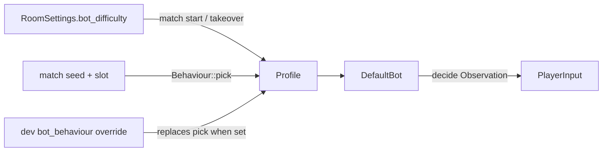

# Data Model: Bot Behaviours and Difficulty Levels

## BotDifficulty (`core::room`, new)

A room setting; plain data, no bot logic.

| Variant | Wire name | Label | Notes |
| --- | --- | --- | --- |
| `Easy` | `"easy"` | Easy | slowest reactions, most mistakes |
| `Medium` | `"medium"` | Medium | **default** |
| `Hard` | `"hard"` | Hard | reacts every tick, no mistakes |

- `ALL: [BotDifficulty; 3]` in menu order Easy, Medium, Hard.
- `name()`, `from_name(&str) -> Option<Self>`, `label()` like `Mode`/`BoardSize`.
- Serde: `rename_all = "lowercase"`, `Default = Medium`.

## RoomSettings (`core::room`, extended)

| Field | Type | Default | Validation |
| --- | --- | --- | --- |
| `name`, `mode`, `size`, `minutes`, `friendly_fire` | unchanged | unchanged | unchanged |
| `bot_difficulty` | `BotDifficulty` | `Medium` | unknown/missing value → `Medium` (serde default and `net::room::from_wire`) |

- New `step_bot_difficulty(step: i8)` wrapping over `BotDifficulty::ALL` (terminal setup screen and
  online lobby key).
- `label()` appends ` - {difficulty.label()} bots`.
- `to_config` does not copy it: the difficulty never changes game rules.
- Editable only by the owner and only in the lobby phase (existing `SetRoom` rules).

## Behaviour (`bots`, new)

| Variant | Meaning |
| --- | --- |
| `Aggressive` | hunts first, farther; approaches the nearest enemy when idle |
| `Protective` | power-ups and digging first, hunts only close enemies, keeps away from enemies |
| `Balanced` | today's priority order |

- `ALL: [Behaviour; 3]`; `pick(seed: u64) -> Behaviour` is uniform and deterministic (salted
  `Rng`, separate from the bot's decision RNG).
- `name()` → `"aggressive" | "protective" | "balanced"`, `from_name(&str) -> Option<Self>`, `label()`.
- Never stored in room settings; on the wire only in developer commands (see below).

## Developer behaviour override (`net`, room and legacy host state)

| Field | Type | Default | Notes |
| --- | --- | --- | --- |
| `bot_behaviour` | `Option<Behaviour>` | `None` (Random) | set by `DevSetBotBehaviour`; owner + developer mode only; used instead of `Behaviour::pick` for bots created after the change |

- Reported in `DevState.behaviour` as the name or `null`.

## Skill (`bots`, new; derived from `BotDifficulty`)

| Field | Type | Easy | Medium | Hard |
| --- | --- | --- | --- | --- |
| `think_every` | `u32` ticks, ≥ 1 | 6 | 3 | 1 |
| `react_ticks` | `u32` ticks | 10 | 5 | 0 |
| `mistake_chance` | `f32` in [0, 1) | 0.20 | 0.06 | 0.0 |

- `Skill::of(BotDifficulty) -> Skill`; invariant: Easy ≥ Medium ≥ Hard on every field, Hard is
  `{1, 0, 0.0}`.

## Profile (`bots`, new)

| Field | Type |
| --- | --- |
| `behaviour` | `Behaviour` |
| `difficulty` | `BotDifficulty` |

- `Profile::pick(seed, difficulty)` = `{ behaviour: Behaviour::pick(seed), difficulty }`.
- `Profile::default()` = Balanced / Hard (today's bot).

## DefaultBot (`bots`, extended)

| Field | Type | Purpose |
| --- | --- | --- |
| `rng` | `Rng` | unchanged decision RNG |
| `profile` | `Profile` | behaviour + difficulty |
| `skill` | `Skill` | derived from `profile.difficulty` |
| `last` | `PlayerInput` | input held between fresh decisions (movement only) |
| `since_think` | `u32` | ticks since the last fresh decision |

- `new(seed)` ≡ `with_profile(seed, Profile::default())`; output identical to today for every
  observation sequence (FR-015).
- `profile()` getter for tests and soak statistics.

### Per-tick decision flow

```text
dead or not Playing           -> no input
since_think + 1 < think_every -> hold last.mv if next square passable and not burning, else no input
otherwise (fresh decision):
  view = observation with opponents' bombs younger than react_ticks removed
  plan = safety layer (unchanged; Protective first steps back from a threat within 3) then the
         behaviour priority table (research R3) on view
  if mistake_chance > 0 and rng.chance(mistake_chance):
      plan is a bomb       -> skip it (no input)
      bot is in danger     -> hesitate (no input)
      otherwise            -> wrong turn (random passable, non-burning neighbour) or hesitate, 50/50
  last = plan (bomb/punch cleared); since_think = 0
```

## Relationships


