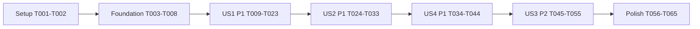

# Tasks: Revenge Karts

**Input**: Design documents from `specs/013-revenge-karts/`.
**Prerequisites**: [plan.md](plan.md), [spec.md](spec.md), [research.md](research.md), [data-model.md](data-model.md), [gameplay contract](contracts/gameplay.md), [snapshot/control contract](contracts/snapshots-and-controls.md), [quickstart.md](quickstart.md).
**Tests**: Required by constitution II and the approved plan's test-first strategy. Every acceptance scenario requires an automated `f13_usN_asM_` test; observe the relevant test fail before implementing its behavior, then rerun it immediately. Compilation failures alone do not prove a behavioral regression: use legacy JSON or existing public fixtures where necessary to obtain a meaningful red test.
**Organization**: Setup, shared prerequisites, then stories in priority order: US1 (P1), US2 (P1), US4 (P1), US3 (P2), followed by final gates. Preserve story numbers from the spec; phase order does not renumber stories.
**Status**: Implementation, automated gates and browser/PTY runtime checks are complete, with evidence in quickstart.md. T064 is blocked on five human playtest participants and remains unchecked; full external acceptance is not claimed. Core acceptance fixtures reuse round_end.rs rather than duplicate helpers across neighboring files.

## Format: `[ID] [P?] [Story] Description`

- `[P]` identifies a task that can run with the other tasks in its explicitly listed parallel wave, after that wave's prerequisites are complete. It never authorizes concurrent edits to the same file.
- `[US1]` through `[US4]` trace tasks to specification stories; shared setup/foundation/polish tasks intentionally omit a story label.
- Paths are repository-relative from `bomberust/`; run Cargo, scripts, and Node commands from `game/` unless stated otherwise. Files marked proposed are the only new implementation files prescribed here.
- Complete each test/implementation pair red then green before proceeding to the next owning slice. A story's initial test tasks may contain separate subcases; do not mark the test task complete until the related implemented cases pass. Do not run ahead into unrelated modules between a change and its focused check.

## Phase 1: Setup (Shared Infrastructure)

**Purpose**: Reuse the current workspace and establish honest validation evidence; do not scaffold another project, change branches, or add dependencies.

- [X] T001 Confirm approval of `specs/013-revenge-karts/spec.md` and `specs/013-revenge-karts/plan.md`, inspect both repository working trees without reverting changes, run the applicable baseline package/JS checks from `specs/013-revenge-karts/quickstart.md`, and record commands, failures, and environment limitations in that guide before implementation.
- [X] T002 Inventory reusable `GameState::custom` fixtures in `game/crates/core/tests/common/mod.rs` and bot/render test helpers; document the selected helper reuse, `f13_usN_asM_` naming, and nonzero filtered-test-count rule in `specs/013-revenge-karts/quickstart.md`, without creating a separate runner or introducing production debug commands.

## Phase 2: Foundational (Blocking Prerequisites)

**Purpose**: Establish shared types, neutral defaults, and compatibility before any story. No kart gameplay is enabled by this phase.

### Tests First

- [X] T003 [P] Add failing additive-snapshot contract cases in `game/crates/net/tests/codec.rs` and `game/crates/web-render/tests/fixtures.rs`: old-shape snapshots decode to neutral additions, new additions survive round trip, stripped additions decode with a legacy event/schema fixture, and invalid index/travel/provenance shapes never panic; keep protocol version, message types, and `Event` variants unchanged.
- [X] T004 [P] Add failing shared-state initialization and validation cases in `game/crates/core/tests/round_end.rs` using existing constructors and serde fixtures: inactive slots and new rounds have no kart/stun/provenance, ordinary bombs default to no source, and contradictory alive/kart state is rejected or inert. Use data-model field constraints as assertions before adding the fields.

### Shared Models and Validation

- [X] T005 Add serde-defaulted `Participant.kart`, `Participant.immobilized_left`, and `KartState` in `game/crates/core/src/state.rs`; quote/enforce kart eligibility "Present only for an active, eliminated Normal/Team participant in a playing round before closing. Incompatible with `alive = true`." and stun "Number of future movement passes blocked by direct-hit stun; at most `config.tick_hz`. Zero for karts and permanently eliminated participants." Implement `index: u16` as "Clockwise virtual perimeter index, strictly less than `2 * (width + height) - 4`, computed with widened arithmetic." Implement `entered_tick: u32` as "Round tick of the elimination creating this kart. Unique per slot per stint because a slot can enter a kart at most once in one tick. Never reused within a round." Implement `cooldown_left: u32` as "Kart movement cooldown; bounded by `config.base_move_cooldown`, initialized to zero." Implement `travel: Option<Dir>` as "Only `Left`, `Right`, or `None`, representing current requested perimeter travel for presentation; not inward throw aim." Implement `pending_return: Option<Pos>` as "Preferred victim square for one earned return, or none. It must be an in-bounds interior position. It is an entitlement, not a reserved square." Keep the default kart absent and stun zero; do not duplicate identity/team inside the kart.
- [X] T006 Add serde-defaulted `Bomb.revenge_stint: Option<u32>` and `Flame.revenge_stints: [Option<u32>; 4]` in `game/crates/core/src/state.rs`, with defaults `None` and all `None`: bomb source is "Entry tick of the owner's kart stint that launched this bomb. Ordinary bombs have none. Source owner remains `Bomb.owner`." Enforce "The entry tick cannot be later than the observation tick." Flame source is "For each owner slot, the newest kart entry tick whose own blast contributed to this flame square." Enforce "A revenge value must have its corresponding owner bit set and must not be in the future." Preserve `owners`, existing statistics, and the exact fixed four-slot shape; source survives landing/kick/punch and never transfers to another bomb through a chain.
- [X] T007 Initialize new fields neutrally in `game/crates/core/src/state.rs`, `game/crates/core/src/bomb.rs`, and `game/crates/core/src/observation.rs`; update affected existing Rust literals/test helpers identified by compiler diagnostics without changing their legacy behavior. Expose shared types from `game/crates/core/src/lib.rs`, preserve the committed old-shape observation fixture for compatibility checks, and rerun T003/T004 plus the narrow compile checks after each owning-file change.
- [X] T008 Add safe added-state validation/projection boundaries in `game/crates/core/src/observation.rs` and `game/crates/web-render/src/ffi.rs`, backed by T003/T004: default missing values, reject malformed typed fields or suppress invalid added entities, validate geometry bounds/future ticks/owner bits/alive-kart contradictions without panics, and never accept client observations as host authority. Run core serde, net codec, and renderer fixture/FFI tests before starting stories.

**Checkpoint**: Shared model and wire compatibility are green; core remains pure, no new dependencies/unsafe code, and legacy states still behave as before.

## Phase 3: User Story 1 - Keep Playing From a Perimeter Kart (Priority: P1)

**Goal**: An eligible eliminated participant can drive around the board and launch inward bombs, visibly and controllably in browser and terminal.
**Independent Test**: Before closing in a non-final Normal/Team situation, eliminate a participant, drive a lap in both directions, release input, throw inward from all edges, and verify identity/team, non-collision, and unchanged Chaser/practice results. No revival is required to test this increment.

### Tests First

- [X] T009 [P] [US1] Add `f13_us1_as2_`, `f13_us1_as3_`, and geometry cases in `game/crates/core/tests/movement.rs`: clockwise/counterclockwise travel, release, ignored up/down/punch, cooldown, every corner/wrap, nearest-edge ties, shared inward lane mapping, all three room sizes, and 255x255 arithmetic without `u8` overflow.
- [X] T010 [P] [US1] Add `f13_us1_as1_`, `f13_us1_as4_`, `f13_us1_as5_`, and `f13_us1_as6_` cases in `game/crates/core/tests/round_end.rs` and `game/crates/core/tests/chaser.rs`: valid entry with identity/team, no inactive/final/practice/Chaser kart, no same-tick action on creation, inward second-square launch and one current-stint bomb despite old owned bombs, no damage/pickup/collision/survivor counting, and harmless overlapping karts.
- [X] T011 [P] [US1] Add `f13_us1_as3_` kart-input regressions in `game/crates/cli/tests/input.rs` and `game/crates/cli/tests/online.rs`: all local-player bindings and online input, opposing held directions neutral, bounded hold expiry, release when supported, ignored vertical/punch actions, unchanged living-player precedence, and focus/menu clearing without assuming universal terminal key-up events.
- [X] T012 [P] [US1] Add `f13_us1_as2_` and `f13_us1_as3_` regressions in `game/crates/web/js-tests/input.test.mjs`, `game/crates/web/js-tests/controls.test.mjs`, and `game/crates/web/js-tests/touch.test.mjs`: remapped keyboard actions, horizontal gamepad/touch intent, opposing D-pad and cross-device neutrality before direction collapse, vertical input not overriding kart horizontal intent, action edges, and focus loss.
- [X] T013 [P] [US1] Add `f13_us1_as1_` and `f13_us1_as2_` rendering/resize cases in `game/crates/cli/tests/view.rs`: actual exterior kart position and identity/team, same-position kart identification, stable gutter, exact minimum sizes 40x22/44x24/56x28, smaller-terminal notice, and fixed two-character cells.
- [X] T014 [P] [US1] Add `f13_us1_as1_`, `f13_us1_as2_`, and `f13_us1_as4_` view/command/interpolation cases in `game/crates/web-render/tests/view.rs`, `game/crates/web-render/tests/commands.rs`, and `game/crates/web-render/tests/interp.rs`: one-tile fixed gutter, four edges/corners, inward identity/team sprite, overlapping karts, smooth lap wrap/corner bends outside the board, and snapshot-gap/entry snapping.

### Implementation

- [X] T015 [US1] Implement pure virtual-ring length, index/edge projection, nearest entry, modulo movement, clamped inward lane, and square-one/square-two helpers in proposed `game/crates/core/src/kart.rs`, exported through `game/crates/core/src/lib.rs`; follow the exact segment counts and Top/Right/Bottom/Left ties in `specs/013-revenge-karts/contracts/gameplay.md`, leave arena tiles untouched, document public helpers, and make T009 geometry cases green.
- [X] T016 [US1] Integrate eligible death-to-kart creation and rotating-priority kart movement in `game/crates/core/src/step.rs` and `game/crates/core/src/kart.rs`: retain `alive = false`, entry tick, identity/team/statistics and owned bombs, clear temporary effects, use base cooldown, restrict actions by tick-entry participation, and keep kart occupancy out of board damage/pickup/outcome paths; make T009/T010 lifecycle cases green.
- [X] T017 [US1] Implement successful kart launch and capacity dispatch in `game/crates/core/src/kart.rs`, `game/crates/core/src/step.rs`, and `game/crates/core/src/bomb.rs`: count one outstanding matching-owner/current-stint bomb, preflight the line with shared punch occupancy, launch airborne at square one with normal fuse/start range/hop timing and source, first hop targets square two on a later tick, update actual ownership/statistics once, and emit only semantically accurate existing events; make T010 launch cases green.
- [X] T018 [US1] Implement kart-aware physical direction reduction and wire forwarding in `game/crates/cli/src/input.rs`, `game/crates/cli/src/app.rs`, and `game/crates/cli/src/online.rs`, using current observation to retain opposing horizontal held intent before `PlayerInput` collapse, preserving all bindings and ordinary controls; make T011 green for local and networked terminal play.
- [X] T019 [US1] Implement kart-aware keyboard/gamepad/touch and cross-device input reduction in `game/crates/web/assets/app.js`, `game/crates/web/assets/controls.js`, and `game/crates/web/assets/touch.js`, retaining existing payload shape, remaps, action edges, focus/menu resets, and living controls; make T012 green without putting targeting or lifecycle rules in JavaScript.
- [X] T020 [US1] Render a spatial kart with identity/team and deterministic same-index visual separation in `game/crates/cli/src/view.rs`; reserve the full-round gutter, consistently update required size/board/status/title offsets, preserve fixed cell widths and undersized-terminal behavior, and make T013 green without extending arena collision bounds.
- [X] T021 [US1] Implement gutter fitting, compact inward-facing kart sprite, shared geometry projection, perimeter-aware interpolation, and identity/team drawing in `game/crates/web-render/src/view.rs`, `game/crates/web-render/src/sprites.rs`, `game/crates/web-render/src/commands.rs`, and `game/crates/web-render/src/interp.rs`; snap on entry/gaps, never interpolate through the board, and make T014 green at desktop/mobile sizes.
- [X] T022 [US1] Add tested kart participant-row status instead of generic dead styling in `game/crates/web/assets/app.js` and `game/crates/web/assets/style.css`, extending `game/crates/web/js-tests/app.test.mjs` before the change; retain colour/team and available gameplay focus/touch controls, with no new settings or explanatory overlay.
- [X] T023 [US1] Run all `f13_us1_` checks and the relevant unfiltered movement/round/Chaser/input/view/renderer/JS suites, verify nonzero scenario counts and complete `f13_us1_as1_` through `f13_us1_as6_` coverage, and record results/first playable kart demonstration in `specs/013-revenge-karts/quickstart.md` before starting US2.

**Checkpoint**: US1 is independently demonstrable. This is a development MVP, not release readiness: US2/US4 complete the P1 combat/cutoff rules and US3 adds the P2 earned return.

## Phase 4: User Story 2 - Disrupt Survivors With Thrown Bombs (Priority: P1)

**Goal**: Dynamic punch-style landing and exactly one second of direct-hit movement stun work without changing ordinary punched bombs or friendly-fire rules.
**Independent Test**: In a hand-built line, throw over every obstacle type and moving/multiple survivors; verify second-square targeting, landing/fallback/refusal, exact stun duration/refresh, allowed bomb/punch actions, and unchanged airborne fuse/chain semantics.

### Tests First

- [X] T024 [P] [US2] Add `f13_us2_as1_`, `f13_us2_as2_`, `f13_us2_as5_`, and `f13_us2_as6_` in `game/crates/core/tests/punch.rs`: first candidate is square two, no initial square-one hit, all obstacle types including airborne bombs, occupancy checked on arrival, far-edge backward search through origin, fully blocked preflight refusal with no capacity/stat cost, dynamic full-line closure after launch, airborne expiry and unchanged ordinary punch behavior.
- [X] T025 [P] [US2] Add `f13_us2_as3_`, `f13_us2_as4_`, and `f13_us2_as7_` in `game/crates/core/tests/movement.rs`, `game/crates/core/tests/malus.rs`, and `game/crates/core/tests/team.rs`: hit without damage, exactly `tick_hz` subsequent blocked movement/kick opportunities at default and non-default rates, refresh not stacking, held movement resumes, bomb/punch stay usable, stun/malus independence and elimination cleanup, multiple hit survivors, and friendly fire both ways.
- [X] T026 [P] [US2] Add kart-flight/stun round-trip and authority cases in `game/crates/net/tests/codec.rs`, including legal empty defaults, impossible/future/forged added state, existing-event decoding, and invariant four-slot provenance; preserve old input envelopes and legacy source-free bombs.

### Implementation

- [X] T027 [US2] Extend shared launch prediction/flight landing in `game/crates/core/src/kart.rs` and `game/crates/core/src/punch.rs` for second-square starts, current occupancy, refusal/fallback and dynamically unavailable landing; keep initial square one non-hitting and fallback search non-hitting, retain existing ordinary punch/kick behavior, and make T024 green.
- [X] T028 [US2] Apply kart-origin flight direct-hit stun in `game/crates/core/src/punch.rs` and friendly-fire relationship handling in `game/crates/core/src/team.rs`; gate movement/kick in `game/crates/core/src/step.rs`, decrement stun after movement but before flight advance, refresh to `tick_hz`, leave bomb/punch/malus/cooldown progression intact, and make T025/T026 green.
- [X] T029 [US2] Add failing then passing stunned-survivor planning cases in `game/crates/bots/tests/danger.rs` and `game/crates/bots/tests/behaviour.rs`, then update `game/crates/bots/src/danger.rs`, `game/crates/bots/src/pathing.rs`, and `game/crates/bots/src/default_bot.rs` so escape predictions account for unavailable movement without private information or otherwise changing difficulty rules.
- [X] T030 [US2] Add failing then passing direct-hit countdown/status cases in `game/crates/cli/tests/view.rs` and implement a distinct stunned-survivor glyph/style and status in `game/crates/cli/src/view.rs` without changing cell width, team identity, or live bomb/punch bindings.
- [X] T031 [US2] Add failing then passing authoritative stun row/model cases in `game/crates/web/js-tests/app.test.mjs`, then update `game/crates/web/assets/app.js` and `game/crates/web/assets/style.css` to display stun/countdown while preserving kart status, gameplay controls, and responsive text layout; do not predict hits in JavaScript.
- [X] T032 [US2] Add failing then passing stunned-survivor command cases in `game/crates/web-render/tests/commands.rs`, then render the authoritative effect in `game/crates/web-render/src/commands.rs` and `game/crates/web-render/src/depth.rs` without new event variants, new game rules, or disrupting kart fitting.
- [X] T033 [US2] Run all `f13_us2_` checks plus unfiltered punch/kick/chain/movement/malus/team, bot danger, codec, CLI view, renderer, and JS tests; verify `f13_us2_as1_` through `f13_us2_as7_` have nonzero coverage and record exact timing/fallback evidence in `specs/013-revenge-karts/quickstart.md` before US4.

**Checkpoint**: US2 can be verified without revival. Thrown bombs and stun are authoritative and consistent across devices/interfaces.

## Phase 5: User Story 4 - Close the Second-Chance Window Consistently (Priority: P1)

**Goal**: Cut off kart play at the first closing warning, clear temporary state on result/rematch, support bots/takeover, and present participation consistently.
**Independent Test**: With kart/bomb/pending-return fixtures, cross the exact cutoff tick, try actions/kills, finish/rematch, and compare browser/terminal observations; verify a living returned-state fixture remains playable. Bot karts must navigate/throw through the public input interface.

### Tests First

- [X] T034 [P] [US4] Add `f13_us4_as1_`, `f13_us4_as2_`, `f13_us4_as3_`, and core `f13_us4_as4_` cases in `game/crates/core/tests/closing.rs`: cutoff before actions and pending return, equality and skipped-start ticks, no kart from later death, old bombs still detonate, returned-state living fixture survives cutoff, no early falling-block advancement, and full result/rematch cleanup including survivor stun. Genuine earned-return integration is rerun after US3.
- [X] T035 [P] [US4] Add lifecycle/takeover and cross-transport `f13_us4_as4_`, `f13_us4_as5_`, and `f13_us4_as6_` cases in `game/crates/net/tests/room_host.rs`, `game/crates/web/tests/lifecycle.rs`, and `game/crates/web/tests/mixed.rs`: transfer exact kart/stint/source/pending/stun state to a replacement bot, no fresh life, same-tick TCP/WebSocket snapshots, round reset, and fixture-driven entry/stun/return/cutoff transitions.
- [X] T036 [P] [US4] Add bot `f13_us4_as6_` tests in `game/crates/bots/tests/behaviour.rs` and `game/crates/bots/tests/parity.rs`: dispatch before dead exits, movement held across think intervals without death-square pathability checks, shortest perimeter targeting/clockwise tie, legal difficulty mistakes/reaction filtering, no intentional teammate target, and reset cached navigation on participation changes.
- [X] T037 [P] [US4] Add `f13_us4_as5_` browser participation/navigation cases in `game/crates/web/js-tests/app.test.mjs` and `game/crates/web/js-tests/glue.test.mjs`: human karts prevent the only-bots/abandoned-match shortcut, entry/return/cutoff fixture snapshots update status/focus, reconnect/gaps render current state, and permanent elimination/ended rounds retain existing navigation behavior.

### Implementation

- [X] T038 [US4] Add shared eligibility/cutoff-at-tick-entry handling in `game/crates/core/src/kart.rs` and `game/crates/core/src/step.rs`, short-circuiting `closing::enabled` before computing start tick and purging karts/pending entitlements before action dispatch; preserve `game/crates/core/src/closing.rs` detonation-before-block timing and let old thrown bombs finish. Make T034 cutoff cases green.
- [X] T039 [US4] Complete result/rematch cleanup in `game/crates/core/src/step.rs` and `game/crates/core/src/state.rs`: remove every kart/pending return and all stun at round end/new construction, keep already-returned living players at closing, and ensure the ended step is a no-op; make T034 cleanup cases green without counting karts as survivors.
- [X] T040 [US4] Preserve complete participant state during human-to-bot takeover in `game/crates/net/src/host.rs` and `game/crates/net/src/room.rs` and any corresponding local session path in `game/crates/cli/src/app.rs`; change controller ownership only, retain old bomb owners/team/identity, and make T035 lifecycle/takeover cases green.
- [X] T041 [US4] Implement kart dispatch/targeting/held-input behavior before dead-player exits in `game/crates/bots/src/default_bot.rs`, using public observation/shared core geometry and landing prediction, existing difficulty cadence/reaction filtering/seeded mistakes, no board-occupancy checks for karts, no teammate targeting, and transition cache resets; make T036 green.
- [X] T042 [US4] Update human-kart participation/navigation and authoritative cutoff/reconnect display in `game/crates/web/assets/app.js`; clear obsolete view interpolation/status in `game/crates/web-render/src/interp.rs` and `game/crates/cli/src/view.rs` without invented events, false extra deaths, or local return/cutoff computation; make T037 green and extend existing view tests before each rendering change.
- [X] T043 [US4] Complete the unchanged-envelope parity checks from T035/T026 in `game/crates/web/tests/mixed.rs` and `game/crates/net/tests/codec.rs`, covering valid/invalid added fields, old defaults, source-bearing flame snapshots, and no new `Event` variants; rerun CLI online and renderer fixtures so TCP, WebSocket, and local views agree.
- [X] T044 [US4] Run all `f13_us4_` tests and unfiltered closing/round/lifecycle/mixed/bot-parity/browser-navigation suites, record `f13_us4_as1_` through `f13_us4_as6_` coverage in `specs/013-revenge-karts/quickstart.md`, and demonstrate the complete P1 kart/stun/cutoff increment; record that true earned-return portions of AS3/AS5/AS6 still require the US3 integration rerun in T055.

**Checkpoint**: P1 behavior is complete without earning revival. US4's cutoff and state-transfer rules are independently tested with valid fixtures; its return-path integration remains an explicit T055 gate, not a falsely completed end-to-end claim.

## Phase 6: User Story 3 - Earn a Return to the Board (Priority: P2)

**Goal**: Reward a current-stint opponent kill with one deterministic safe return before winner selection, preserving ownership and preventing stale-source rewards.
**Independent Test**: Produce a qualifying kart-bomb kill, verify immediate safe return/reset, reject nonqualifying ownership/team/stint cases, then eliminate and return the participant again; resolve simultaneous returns and last-survivor/team outcomes.

### Tests First

- [X] T045 [P] [US3] Add `f13_us3_as1_` attribution and `f13_us3_as4_` rejection cases in `game/crates/core/tests/chain.rs` and `game/crates/core/tests/team.rs`: current-stint own-blast contribution, lingering/refreshed flame merging, no chain-trigger credit transfer, no teammate/pre-death/wrong-owner/stale-stint reward, normal kill counters unchanged, and no return from a board participant newly killed in the same tick.
- [X] T046 [P] [US3] Add `f13_us3_as1_`, `f13_us3_as2_`, `f13_us3_as3_`, `f13_us3_as5_`, `f13_us3_as6_`, and `f13_us3_as7_` cases in `game/crates/core/tests/round_end.rs`: safe-square exclusions, `(distance,y,x)` ties, slot/victim order, non-overlapping simultaneous return, no-safe pending/retry/no stockpile, exact power reset with statistics/owned bombs retained, repeat stints, return-before-winner/draw/team outcome, and unavailable pending returns never postponing a result.
- [X] T047 [P] [US3] Add actual-return transition regressions in `game/crates/cli/tests/view.rs`, `game/crates/web/js-tests/app.test.mjs`, `game/crates/web-render/tests/interp.rs`, and `game/crates/bots/tests/behaviour.rs`, using `f13_us3_as2_`, `f13_us3_as6_`, and `f13_us4_as5_`/`f13_us4_as6_` names as appropriate: remove kart/stun, snap to authoritative spawn, retain identity/team, and resume ordinary inputs/AI with normal capacity and no stale navigation.

### Implementation

- [X] T048 [US3] Propagate bomb current-stint provenance only across its own blast tiles in `game/crates/core/src/bomb.rs`, merging `Flame.revenge_stints` per owner by maximum alongside unchanged owner-bit OR and refreshed flame lifetime; retain source through flight/kick/landing, do not transfer it to chain-triggered bombs, and make T045 provenance cases green.
- [X] T049 [US3] Gather bounded tick-local elimination records and qualifying sources in `game/crates/core/src/step.rs` before mutating return states; use tick-entry matching karts and actual opponent/hurting blast contributions, preserve normal cumulative kill credit, choose the lowest-slot victim per owner, and make T045 rejection/iteration-order cases green without an unbounded history.
- [X] T050 [US3] Implement one pending entitlement and safe-square selection in `game/crates/core/src/kart.rs`, retaining the original preferred square and ordering owners by slot/candidates by `(Manhattan distance,y,x)`; quote/enforce "Safe return square: interior floor, no bomb (airborne or landed), no alive player, no active flame. Items do not block returning. Walls/blocks and remaining survivors are never removed for a return." Reserve selected squares through actual living state, not terrain mutation; make T046 search/pending cases green.
- [X] T051 [US3] Integrate return resolution after all eliminations and before tick-end outcome in `game/crates/core/src/step.rs` and restore round-start Normal/Team powers in `game/crates/core/src/state.rs`; preserve identity/team/stats/owned bombs, recompute actual `bombs_active`, clear elimination order and temporary effects without a new shield, honor the existing cutoff, allow repeat stints, and make all T045/T046 cases green. Enforce "One return per stint is implicit: consuming a return removes that kart, and a later death creates a different `entered_tick`. No once-per-round boolean is introduced."
- [X] T052 [US3] Resume normal survivor planning after genuine return in `game/crates/bots/src/default_bot.rs` and `game/crates/bots/src/danger.rs`, resetting kart-specific held/cached state while retaining difficulty/behavior profile, honoring outstanding bombs and any later stun, and make T047 bot transitions green without awarding private information.
- [X] T053 [US3] Integrate genuine return/status/interpolation transitions in `game/crates/cli/src/view.rs`, `game/crates/web/assets/app.js`, `game/crates/web-render/src/interp.rs`, and `game/crates/web-render/src/commands.rs`; consume authoritative snapshots, snap across participation changes/reconnects, preserve identity/team and ordinary controls, and make T047 interface cases green without new messages/events.
- [X] T054 [US3] Add and run deterministic multi-stint, simultaneous-return, stale-flame, all-room-size, mode, and cutoff sequences in `game/crates/core/tests/determinism.rs`, comparing full state and event logs for identical initial state/seed/ordered inputs; test tick-zero entry, non-default rates, no slot-iteration bias, and ownership count exceeding reset placement capacity without extra bombs.
- [X] T055 [US3] Run `f13_us3_` and rerun every `f13_us4_` acceptance case through genuine earned returns, plus unfiltered chain/team/round/closing/determinism, mixed transport, CLI, renderer, JS, and bot soak tests; verify `f13_us3_as1_` through `f13_us3_as7_` coverage and actual US4 AS3/AS5/AS6 integration, and record results in `specs/013-revenge-karts/quickstart.md`.

**Checkpoint**: All four stories work together; revenge eligibility, returns, final outcomes, and cutoff are proven through real simulation transitions rather than only fixtures.

## Phase 7: Polish & Cross-Cutting Concerns

**Purpose**: Complete player documentation and all required verification; no unrelated refactoring or new features.

- [X] T056 [P] Update `game/README.md` and `game/docs/GAMEPLAY.md` with automatic Normal/Team-only kart eligibility, clockwise/counterclockwise controls, inward second-square throws/skip/fallback, friendly-fire stun, current-stint opponent-only revival/reset, immediate outcome rules, and first-warning cutoff; state that no new flag/binding/power is added.
- [X] T057 [P] Update `game/docs/PROTOCOL.md` and `game/docs/WEB.md` for exact added snapshot fields/defaults/validation, unchanged input/message/event/version contracts and legacy rendering limitation, responsive outside-board rendering, and terminal minima 40x22/44x24/56x28; run the existing web docs/consistency tests after documentation edits.
- [X] T058 [P] Extend `game/scripts/check-scenarios.sh` to recognize every feature-013 `f13_usN_asM_` acceptance prefix and fail on missing/nonzero-coverage violations, adding a reproducible missing-prefix failure check before changing it; document focused commands, fixtures, PTY/browser validation, and feature-013 scanner usage in `game/docs/DEVELOPMENT.md` without disrupting older feature coverage.
- [X] T059 Finish adversarial/compatibility/size tests in `game/crates/net/tests/codec.rs`, `game/crates/web/tests/fuzz.rs`, and `game/crates/web-render/tests/ffi.rs`: malformed/future/contradictory added state, spoofed ownership/returns, bad source-array length, old-shape fixture neutrality, no unknown events, and worst-case supported-room snapshots under 64 KiB with multiple source-bearing flames; use bounded data rather than raising protocol limits.
- [X] T060 Run `bash scripts/build-wasm.sh` from `game/`, verify/update `game/crates/web/assets/eksplode_re_render.wasm` and only genuinely affected expected renderer fixtures through existing tooling, preserve an old-shape compatibility case in `game/crates/web-render/tests/fixtures.rs`, and verify the WASM asset remains within the documented 300 KB budget.
- [X] T061 Run `cargo fmt --check`, `cargo clippy --workspace --all-targets -- -D warnings`, `cargo test --workspace`, `(cd crates/web/js-tests && node --test)`, `python3 scripts/pty-enter-check.py`, and `bash scripts/check-scenarios.sh` from `game/`; record real outcomes and any unrelated baseline failures in `specs/013-revenge-karts/quickstart.md`, fixing only feature-related regressions and not claiming completion on empty filtered suites.
- [X] T062 Follow `specs/013-revenge-karts/quickstart.md` browser end-to-end checks with the rebuilt server at desktop 1280x800 and mobile 390x844/orientation changes: capture actual entry/laps/corners/stun/return/cutoff/rematch, verify moving non-background canvas pixels in kart regions, no clipping/overlap/through-board interpolation, four identifiable karts, keyboard/gamepad/touch operation, mixed terminal/browser parity, and input-to-visible-update p95 no worse than 200 ms; record measurements/screenshots and stop the test server afterward unless still needed.
- [X] T063 Follow the local/online terminal smoke scenarios in `specs/013-revenge-karts/quickstart.md`, exercising every board size, exact/undersized/resized terminal, four local bindings, human-to-bot takeover, stun/return/cutoff, and unchanged Team/Chaser/practice outcomes; record PTY evidence and resolve feature-related layout/input failures.
- [ ] T064 Conduct the SC-007 five-person playtest in `specs/013-revenge-karts/quickstart.md` without coaching: at least four of five independently drive around a corner, throw inward, and explain revival/cutoff within two minutes after first elimination; record observed counts/times, or explicitly leave this task blocked/uncompleted if participants are unavailable rather than fabricating a result.
- [X] T065 Reconcile every FR-001 through FR-021, SC-001 through SC-007, and all 26 acceptance prefixes against executed automated/manual evidence in `specs/013-revenge-karts/quickstart.md` and `specs/013-revenge-karts/tasks.md`; mark tasks complete only with actual evidence, disclose any blocked gate, rerun relevant focused tests after final fixes, and confirm the scoped diff preserves unrelated work with no new mode/setting/dependency/event/unsafe code.

## Dependencies & Execution Order

### Phase Dependencies

1. T001 then T002 establish baseline and reuse decisions.
2. T003/T004 form the foundational red-test wave. T005 then T006 establish shared fields; T007 updates defaults/literals, T008 validates the boundary. All must finish before story work.
3. US1: T009-T014 are a disjoint red-test wave after T008. T015 -> T016 -> T017 establishes core behavior. T018-T022 consume that stable core contract in listed order; T023 validates the checkpoint. Frontend edits are intentionally not marked parallel because some share glue/status files.
4. US2: T024-T026 red tests start after T023; T027 -> T028 completes flight/stun. T029-T032 integrate bots and both views, then T033 validates. No revival behavior is required yet.
5. US4: T034-T037 red tests start after T033; T038 -> T039 establishes cutoff/cleanup. T040 -> T041 -> T042 -> T043 integrates takeover/bots/views/parity, then T044 validates the P1 increment. AS3/AS5/AS6 first use explicit returned-state fixtures; their actual return path remains mandatory at T055.
6. US3: T045-T047 red tests start after T044; T048 -> T049 -> T050 -> T051 implements provenance-to-return. T052 -> T053 -> T054 integrates survivor AI/views/determinism; T055 reruns full US3/US4 integration.
7. Polish: T056-T058 are a disjoint documentation/scanner wave after T055. T059 security/compatibility then T060 asset build precede T061 gates; T062/T063 smoke checks and T064 playtest precede T065 final reconciliation. After any late code/doc fix, rerun its focused validation and any affected merge gate.

### User Story Dependency Graph

US2 depends on US1's real kart/launch state. US4 depends on US1/US2 to validate the complete P1 lifecycle and stun cleanup. US3 consumes their settled lifecycle/cutoff/provenance shape, then reruns US4 with earned returns. These are explicit integration dependencies, not a claim that the four stories can be built in parallel. Each checkpoint has an independent prepared-state test of its own added behavior.

### Within Each Story

Tests precede production behavior; models and pure helpers precede tick integration; core decisions precede UI/AI use; each production slice is immediately followed by its named narrow test; checkpoint validation precedes the next priority. Preserve default bomb attribution, legacy movement, Chaser, deterministic ordering, and unchanged wire events throughout. Never substitute manual smoke for rule tests.

## Parallel Execution Examples

These are optional scheduling examples, not instructions to spawn agents automatically. Files within each wave are disjoint; no later wave begins before its prerequisite checkpoint. Do not edit the same common fixture concurrently.

| Wave | Prerequisite | Parallel Tasks / File Ownership |
|------|--------------|---------------------------------|
| Foundation | T002 | T003: net codec + renderer fixtures; T004: core round state tests. |
| US1 | T008 | T009: core movement; T010: core round/Chaser; T011: CLI input/online; T012: JS input/controls/touch; T013: CLI view; T014: WASM view/commands/interp tests. |
| US2 | T023 | T024: core punch; T025: core movement/malus/team; T026: net codec. |
| US4 | T033 | T034: core closing; T035: net room + web lifecycle/mixed; T036: bot behavior/parity; T037: JS app/glue. |
| US3 | T044 | T045: core chain/team; T046: core round_end; T047: CLI view + JS app + WASM interp + bot behavior. |
| Polish | T055 | T056: README/GAMEPLAY; T057: PROTOCOL/WEB; T058: DEVELOPMENT/scenario scanner. |

For example, after T008, different implementers can write T011's terminal input regressions and T014's renderer regressions concurrently; after merging them, core implementation proceeds through T015-T017 before adapter/render changes. For US3, T045 and T046 can be written together because attribution and spawn-order tests use different files, but T048-T051 remain sequential owners of the same simulation slice.

## Requirement Traceability

| Requirement | Primary Tasks |
|-------------|---------------|
| FR-001 | T010, T016, T034, T038 |
| FR-002 | T009, T013-T016, T020-T022 |
| FR-003 | T009, T011-T012, T015-T019 |
| FR-004 | T009-T010, T015-T016 |
| FR-005 | T010, T017, T024, T027 |
| FR-006 | T024, T027 |
| FR-007 | T025, T028 |
| FR-008 | T025, T028-T032 |
| FR-009 | T024, T027-T028, T045, T048 |
| FR-010 | T045, T048-T049 |
| FR-011 | T046, T050-T051 |
| FR-012 | T034, T038, T046, T050-T051 |
| FR-013 | T010, T017, T046, T051-T054 |
| FR-014 | T010, T016, T046, T049-T051 |
| FR-015 | T034, T038, T055 |
| FR-016 | T034, T038, T055 |
| FR-017 | T004, T034-T035, T039-T040, T055 |
| FR-018 | T029, T035-T036, T040-T041, T047, T052, T055 |
| FR-019 | T011-T014, T018-T022, T030-T032, T037, T042-T043, T047, T053 |
| FR-020 | T009, T015, T054, T055, T062-T063 |
| FR-021 | T056-T058, T065 |

| Success Criterion | Evidence Tasks |
|-------------------|----------------|
| SC-001 | T010, T016, T023, T062-T063 |
| SC-002 | T009, T011-T015, T018-T021, T023, T062-T063 |
| SC-003 | T024-T028, T033 |
| SC-004 | T045-T051, T054-T055 |
| SC-005 | T034-T044, T055, T062-T063 |
| SC-006 | T003-T008, T035-T037, T043, T047, T053-T055, T059-T063 |
| SC-007 | T056, T064 |

Acceptance prefixes are enumerated in each story's test tasks and checked against the complete 26-row table in [quickstart.md](quickstart.md). Never mark an entire prefix covered because a filtered command matched zero tests.

## Implementation Strategy

### MVP First

Complete Setup + Foundation + US1 and stop at T023 for the first independently playable perimeter-kart demonstration. This intentionally does not claim earned revival or a release-ready full feature. The release-safe P1 MVP includes US1 + US2 + US4 through T044 and the applicable polish/gates, so throws/stun/cutoff and bot/interface parity are not omitted. Complete US3 and all final gates for the full requested feature.

### Incremental Delivery

1. Establish neutral additive state without altering gameplay.
2. Deliver visible kart travel and inward launch in both interfaces.
3. Add dynamic targeting and exact movement stun without changing ordinary punch rules.
4. Enforce closing/result boundaries and bot/network/navigation participation.
5. Add provenance-checked returns before results, preserving actual bomb ownership.
6. Finish documentation, nonempty scenario coverage, compatibility/security checks, WASM build, repository gates, browser/terminal smoke, and comprehension evidence.

### Scope and Completion Notes

No new mode, room flag, power, keybinding, network event, dependency, persistence, or unsafe block is authorized. Use existing test files/helpers rather than one test file per task. Do not commit or change branches automatically. The five-person playtest is a genuine external gate: if unavailable, leave T064 incomplete and disclose the blocker. Update this checklist only as implementation work and actual evidence warrant.