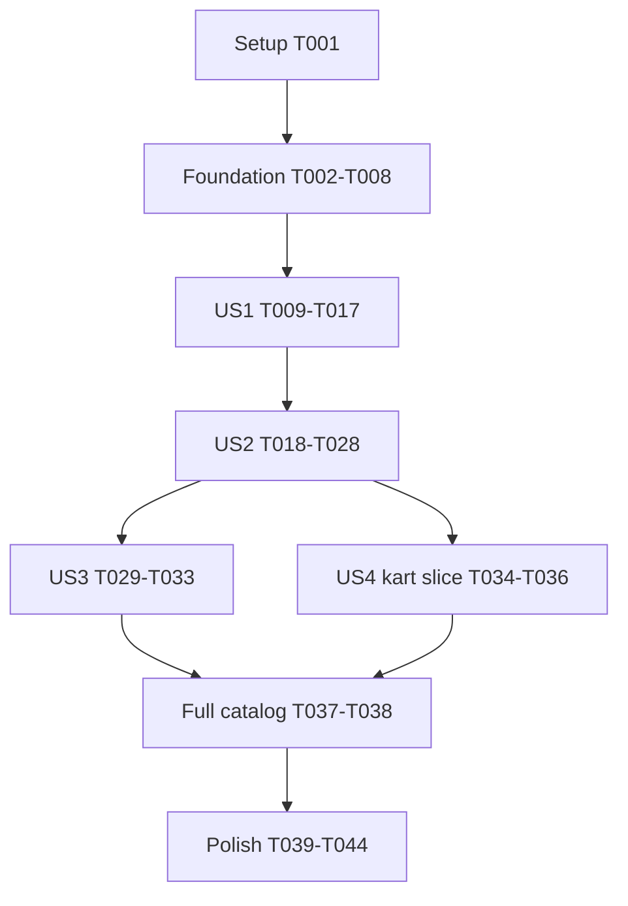

# Tasks: Animated Lobby Scene

**Input**: Design documents from `specs/014-lobby-animation/`.

**Prerequisites**: [plan.md](plan.md), [spec.md](spec.md), [research.md](research.md), [data-model.md](data-model.md), [contracts/lobby-scene.md](contracts/lobby-scene.md), and [quickstart.md](quickstart.md). Specification and plan approval precede application code.

**Tests**: Required by the constitution and plan. Write each slice's tests, run them and observe the expected failure, then implement that slice and rerun the same checks. A filter matching zero tests is not a pass. Existing test helpers should be reused.

**Organization**: Setup, shared prerequisites, four user-story phases in priority order, then cross-cutting validation. The target is the existing main-menu logo, not the room lobby. No gameplay rules, protocol messages, persistent settings, new packages, branches, or commits are authorized by this task list.

## Format: `[ID] [P?] [Story] Description`

- Every task has an unchecked box, sequential ID, exact file paths, and its own story label when inside a story phase.
- `[P]` means the task can run with the other tasks in its explicitly listed parallel wave after that wave's prerequisites are complete. It never means it can bypass red-first ordering.
- Paths and links are repository-relative; documentation links resolve from this feature directory. A path identified as new is created during implementation, not during task generation.

## Path Conventions

- Rust rendering: `game/crates/web-render/`; browser presentation and embedded assets: `game/crates/web/`.
- Native tests use the existing FFI suite and one new focused file at game/crates/web-render/tests/lobby.rs. JS tests reuse existing files.
- Real-browser assertions extend the existing [game/scripts/browser-smoke.mjs](../../game/scripts/browser-smoke.mjs) with an isolated `--lobby-scene` mode using `BASE_URL`, defaulting to `http://127.0.0.1:8080`. Preserve existing modes; do not rely on its outdated Join-first flow or add a production scene selector.
- Run commands from the repository root unless a task explicitly says otherwise. Do not overwrite unrelated working-tree changes.

## Phase 1: Setup (Shared Infrastructure)

**Purpose**: Verify the existing project and establish reproducible validation without scaffolding a new application.

- [X] T001 Verify Rust stable with the workspace minimum Rust 1.75, Node.js, the existing browser automation loader, and the wasm32-unknown-unknown target against [game/Cargo.toml](../../game/Cargo.toml) and [game/scripts/build-wasm.sh](../../game/scripts/build-wasm.sh); record tool versions, actual Git branch, existing dirty paths, baseline asset sizes, and any pre-existing focused-test failures in [specs/014-lobby-animation/quickstart.md](quickstart.md), without modifying unrelated files or installing a new application dependency.

## Phase 2: Foundational (Blocking Prerequisites)

**Purpose**: Establish shared presentation state and the additive WASM boundary. No story implementation starts before this phase is green.

### Red-First Boundary Tests

- [X] T002 [P] Add and run failing shared-model tests in the new game/crates/web-render/tests/lobby.rs for initialized seeded state, advance input rejection without mutation, finite scene samples, and bounded collections; quote and assert the model's "seven VignetteKind values", "integer 0 through 6", "integer 0 through 299", "exactly 300", "up to four authored actor tracks", and "up to three authored bomb tracks" constraints.
- [X] T003 [P] Add and run failing additive-FFI contract tests in [game/crates/web-render/tests/ffi.rs](../../game/crates/web-render/tests/ffi.rs) for uninitialized calls, reset, invalid ticks, invalid sizes/interpolation, 16-float output, and preservation of observations, looks, interpolation, and picking geometry; assert advance statuses 0/1/2, frame zero on error, dimensions "finite, positive, and at most 8,192", and alpha "finite and in [0, 1)" from [specs/014-lobby-animation/contracts/lobby-scene.md](contracts/lobby-scene.md).
- [X] T004 [P] Add and run failing renderer-wrapper contract tests in [game/crates/web/js-tests/glue.test.mjs](../../game/crates/web/js-tests/glue.test.mjs) for optional export detection, seed "0..4294967295", bounded integer ticks, unchanged command stride, missing-export fallback, immediate output consumption, and reconstructing typed-array views after memory growth; reuse existing fake export/context helpers.

### Shared Implementation

- [X] T005 Create shared timeline types and validated reset/advance state in the new game/crates/web-render/src/lobby.rs and register the module in [game/crates/web-render/src/lib.rs](../../game/crates/web-render/src/lib.rs); retain the model's exact domains: rng "existing core Rng", deck "seven VignetteKind values", cursor "integer 0 through 6", local_tick "integer 0 through 299", previous_kind "optional VignetteKind", kind "one of seven values below", and duration_ticks "exactly 300"; seed from an injected unsigned 32-bit value widened to u64, accept "0 through 15 ticks" with zero a no-op, reject larger inputs without mutation, and make sampling RNG-free.
- [X] T006 Define bounded frame, actor, bomb, and effect types plus a finite static stage command builder in the new game/crates/web-render/src/lobby.rs; preserve the model's "bounded list of DecorativeActor", "bounded list of DecorativeBomb", "bounded list of DecorativeEffect", "local_tick plus interpolation", "set of authored motifs", and "currently visible motifs" fields; actor domains are "local actor index", "existing Look value", "Left or Right", "Background or Foreground", "finite logical x/y", "Idle, StepA, StepB, Push, Ride, Squash, Gone", and "bounded finite values"; bomb roles are "Dropped, Pushed, Incoming" and states "Absent, Fuse, Moving, Blast, Cleared"; effects are "LocalBlast, Smoke, Flatten" and "bounded timed effects" with bounded lifetimes; enforce "up to four authored actor tracks", "up to three authored bomb tracks", a 640 by 200 stage, finite commands, and no core events or game-state dependencies.
- [X] T007 Implement eksplode_re_lobby_reset, eksplode_re_lobby_advance, and eksplode_re_lobby_frame in [game/crates/web-render/src/ffi.rs](../../game/crates/web-render/src/ffi.rs) using the independent timeline and existing shared output buffer; honor T003's statuses, invalid-output clearing, size/alpha bounds, nonmutating sampling, and gameplay-state isolation; keep all memory exchange inside the existing FFI module and rerun T002/T003 until green.
- [X] T008 Extend createRenderer in [game/crates/web/assets/app.js](../../game/crates/web/assets/app.js) with lobbyAvailable, resetLobby, advanceLobby, and lobbyFrame according to [specs/014-lobby-animation/contracts/lobby-scene.md](contracts/lobby-scene.md); feature-detect all three exports, validate inputs, return the existing command shape, isolate unsupported/status failures, avoid cached stale WASM views, and rerun T004 plus existing glue tests until green.

**Checkpoint**: Shared boundaries pass focused tests. Frame output is valid without a match observation, and scene operations do not mutate gameplay state. Animated choreography remains in its owning story below.

## Phase 3: User Story 1 - See a Living Lobby Instead of a Static Logo (Priority: P1)

**Goal**: Replace the main-menu logo with side-view running, bomb dropping, local explosions, and continuous seeded scheduling.

**Independent Test**: Sample RunDrop through entrance, run, drop, fuse, blast, safe exit, and rollover using native fixtures, then verify real WASM paints the same running sequence in the former logo zone. Use fixture-controlled seeds, not a production scene selector. Full-catalog 90-second variety is a cross-story gate after US3 and US4; do not claim that result at this checkpoint.

### Tests for User Story 1

- [X] T009 [P] [US1] Add and run failing f14_us1_as2_, f14_us1_as3_, f14_us1_as4_, and f14_us1_as5_ tests in game/crates/web-render/tests/lobby.rs for side-facing running/drop/fuse/blast/cleared samples, safe exit, frame-rate-independent sampling, seven-item shuffled decks, deterministic replay, varied seed orders, no identical deck-boundary neighbors, and all 49 adjacent deck-position pairs; assert the first moving character is on screen "within 60 ticks", each action completes "by tick 299", and no blank transition exceeds two seconds, while leaving full rendered-catalog coverage to T034/T037.
- [X] T010 [P] [US1] Replace the intentional old-logo assertion and add failing f14_us1_as1_ menu-contract checks in [game/crates/web/js-tests/app.test.mjs](../../game/crates/web/js-tests/app.test.mjs) for the removed logo zone, new decorative scene/fallback elements, retained game heading/name input, exactly four existing primary menu actions including Customize, and unchanged room-lobby markup and behavior.
- [X] T011 [P] [US1] Add the isolated --lobby-scene mode with repeatable f14_us1_as1_ browser startup and moving-pixel assertions to [game/scripts/browser-smoke.mjs](../../game/scripts/browser-smoke.mjs); navigate the actual main menu, accept BASE_URL, verify a nonblank moving side-view character within one second of the menu becoming usable including graphics startup latency, preserve existing smoke modes, and run against the current app to observe the expected old-logo failure.

### Implementation for User Story 1

- [X] T012 [US1] Implement Fisher-Yates deck construction/refill and tick rollover in game/crates/web-render/src/lobby.rs using existing core Rng and exactly RunDrop, SameLevel, CounterRunBlast, BackgroundRun, KartLeft, KartRight, and PushSquash identities; keep each duration at 300 ticks, consume randomness only at reset/refill, prevent equal boundary neighbors without losing items, and preserve the 35-second deck and 65-second worst event-gap proof from [specs/014-lobby-animation/research.md](research.md).
- [X] T013 [US1] Implement RunDrop sampling and 2D pixel-art commands in game/crates/web-render/src/lobby.rs using existing side-profile look runs, step frames, bomb artwork, flame/smoke colours, readable timed fuses, localized blasts, and safe exits; uniformly fit and clip the 640 by 200 logical stage, keep actual looks untouched, clear effects before rollover, and rerun T009's running/deck checks.
- [X] T014 [US1] Replace canvas#logo with the reserved lobby-scene area, lobby-scene-canvas, and lobby-scene-fallback image element in [game/crates/web/assets/index.html](../../game/crates/web/assets/index.html); preserve the h1, name input, menu-create, menu-join, menu-customize, menu-options, retry, and room-lobby DOM; use aria-hidden, empty image alt, no artwork tabindex, and no explanatory feature copy, then rerun T010.
- [X] T015 [US1] Replace the old logo styling with an unframed stable 640:200 responsive scene area in [game/crates/web/assets/style.css](../../game/crates/web/assets/style.css); clip entrants/effects, keep artwork pointer-transparent, cap backing dimensions through controller sizing at 8,192 per axis, and accommodate existing narrow/short-landscape layouts without introducing scrolling, content shifts, cards, or obsolete #join-panel > #logo rules for the new scene.
- [X] T016 [US1] Add one scene controller owned by start() in [game/crates/web/assets/app.js](../../game/crates/web/assets/app.js), replacing paintLogo and both its updateUi/renderEditor call sites; inject one u32 Web Crypto seed per visit with a documented fixed fallback seed, track readiness/menu visibility, paint returned commands immediately, and use one RAF with 60 Hz ticks; define fractional_ticks and last_alpha as "value in [0, 1)", raf_handle as "optional browser handle", and previous_timestamp as "optional finite time"; resizing and repeated UI/customization updates must not reset or duplicate the scene. Complete pause/preference/error lifecycle in US2 before release.
- [X] T017 [US1] Rebuild [game/crates/web/assets/eksplode_re_render.wasm](../../game/crates/web/assets/eksplode_re_render.wasm) through [game/scripts/build-wasm.sh](../../game/scripts/build-wasm.sh), rerun US1 native/glue/menu checks, and run the implemented RunDrop browser assertions in [game/scripts/browser-smoke.mjs](../../game/scripts/browser-smoke.mjs); record actual red/green results and first-paint evidence in [specs/014-lobby-animation/quickstart.md](quickstart.md), explicitly identifying full-catalog or accessibility checks still waiting for later stories rather than treating empty/unimplemented variants as complete.

**Checkpoint**: The running/drop vignette and seeded scheduler can be tested independently. Intermediate incomplete catalogs are development checkpoints, not feature-complete releases or substitutes for the full acceptance gate.

## Phase 4: User Story 2 - Continue Using a Comfortable, Accessible Menu (Priority: P1)

**Goal**: Preserve menu actions and focus, support pause/reduced motion, stop hidden work, and retain a usable static menu when animation fails.

**Independent Test**: With a running fixture, exercise all menu actions and pause/resume through supported inputs; change reduced motion live; navigate away and return; resize; inject missing exports, drawing failures, missing Canvas, and total WASM-load failure. Confirm still art, retained controls, frozen ticks, and no duplicate loop.

### Tests for User Story 2

- [X] T018 [P] [US2] Add and run failing f14_us2_as2_, f14_us2_as3_, and f14_us2_as6_ lifecycle tests in [game/crates/web/js-tests/lobby.test.mjs](../../game/crates/web/js-tests/lobby.test.mjs) using existing fake frames; assert "boolean" domains for user_paused, reduced_motion, menu_visible, covered, document_visible, renderer_ready, and failed remain separate, retain the explicit pause through navigation/preference changes, reset RAF origin without resetting timeline, discard hidden time, treat backward time as zero, reject non-finite times, cap active delta at 250 ms/15 ticks, and detach controller listeners on teardown.
- [X] T019 [P] [US2] Add and run failing f14_us2_as1_ and f14_us2_as3_ focus/input tests in [game/crates/web/js-tests/nav-focus.test.mjs](../../game/crates/web/js-tests/nav-focus.test.mjs) for an accessible native pause button outside .menu-actions and after existing actions, preserved default focus/order and stable IDs, keyboard/controller activation, pointer/touch compatibility, aria-pressed=user_paused, and no artwork focus targets or live announcements.
- [X] T020 [P] [US2] Add and run failing f14_us2_as5_ HTTP checks in [game/crates/web/tests/http.rs](../../game/crates/web/tests/http.rs) for GET /lobby-scene.png, a real PNG signature, image/png MIME, unchanged CSP/security behavior, and aggregate accounting of every embedded page asset including previously omitted routes; retain hard limits of 307,200 bytes WASM and 512,000 bytes complete page assets.
- [X] T021 [P] [US2] Add and run failing f14_us2_as5_ failure-isolation checks in [game/crates/web/js-tests/glue.test.mjs](../../game/crates/web/js-tests/glue.test.mjs) for older WASM missing exports, scene-only status/draw exceptions, zero invalid command results, unavailable Canvas, PNG failure, and total WASM-load failure; menu/network state must remain usable for decorative failure while genuine connection failures and gameplay renderer errors still surface correctly.
- [X] T022 [P] [US2] Add and run failing f14_us2_as1_ through f14_us2_as6_ browser checks in [game/scripts/browser-smoke.mjs](../../game/scripts/browser-smoke.mjs) for actual menu interaction, pause pixels/semantics, live reduced-motion emulation, retained pause across screen/tab hiding, old-export and blocked-WASM/Canvas fallbacks, and bounding-box/overflow/layout stability at 1440x900, 390x844, 320x568, and 844x390 plus any smaller supported width; use isolated browser contexts and preserve existing smoke modes.

### Implementation for User Story 2

- [X] T023 [US2] Generate the new first-party static asset at game/crates/web/assets/lobby-scene.png from a representative frame of the Rust scene, reusing its palette and visible character/bomb identity; keep it small enough for T020's unchanged aggregate budget and legible at the supported menu widths, without external imagery or a new runtime dependency.
- [X] T024 [US2] Embed the generated PNG with the exact /lobby-scene.png route and image/png MIME in [game/crates/web/src/assets.rs](../../game/crates/web/src/assets.rs), preserve cache/security handling and CSP, and rerun T020 using a freshly rebuilt server so both PNG correctness and complete asset accounting pass.
- [X] T025 [US2] Complete controller motion/visibility and pause state in [game/crates/web/assets/app.js](../../game/crates/web/assets/app.js) using the activity conjunction in [specs/014-lobby-animation/data-model.md](data-model.md); subscribe to live matchMedia changes, actual screens(state).mainMenu visibility, modal coverage, document visibility and resize, freeze explicit pauses and hidden timelines, retain "value in [0, 1)" fractional state, discard hidden elapsed time, keep one loop, and clean up listeners without altering the existing room-lobby Animator; rerun T018.
- [X] T026 [US2] Refine loadGraphics and optional-scene failure handling in [game/crates/web/assets/app.js](../../game/crates/web/assets/app.js) so older scene exports, scene drawing errors, missing Canvas, or missing WASM show the PNG without turning a decorative failure into global stage=closed; preserve networking/menu actions and genuine network failure reporting, guard actual gameplay rendering with its existing graphics error presentation rather than pretending matches can render without WASM, and rerun T021.
- [X] T027 [US2] Add the separate native lobby-scene-pause icon button and presentation states in [game/crates/web/assets/index.html](../../game/crates/web/assets/index.html), [game/crates/web/assets/style.css](../../game/crates/web/assets/style.css), and [game/crates/web/assets/app.js](../../game/crates/web/assets/app.js); follow current icon conventions, use Pause animation/Resume animation labels and tooltips, bind aria-pressed to explicit pause, disable with an accessible explanation for reduced-motion/fallback states without clearing pause choice, preserve all four primary actions and default focus, and rerun T019.
- [X] T028 [US2] Run the US2 Node, HTTP, and real-browser checks after rebuilding embedded assets; record input/focus, frozen-pixel, fallback, reduced-motion, hidden-tab, and responsive evidence in [specs/014-lobby-animation/quickstart.md](quickstart.md), with screenshots under [game/docs/screenshots/](../../game/docs/screenshots/); confirm no scene audio, protocol traffic, room-state mutation, flash bursts, or off-menu RAF activity and keep any unverified physical-controller check explicit.

**Checkpoint**: The running scene is a comfortable menu enhancement with independent accessibility and failure coverage. User-selected pause lasts only for the current page visit; no local-storage key is added.

## Phase 5: User Story 3 - Watch Playful Encounters With Other Characters (Priority: P2)

**Goal**: Add same/opposite-direction encounters, visible background depth, occasional lead-character explosions, and the pushed-bomb/incoming-bomb flattening gag.

**Independent Test**: Sample SameLevel, CounterRunBlast, BackgroundRun, and PushSquash at their fixed cue offsets and transitions, then observe their actual WASM pixels. No real opponent or room roster is required.

### Tests for User Story 3

- [X] T029 [P] [US3] Add and run failing f14_us3_as1_ through f14_us3_as6_ native tests in game/crates/web-render/tests/lobby.rs for distinct actor looks and same/opposing directions, safe exits versus lead-character blast elimination, smaller background baseline/scale and back-to-front command order, and a visible Push-to-Squash-to-Gone transition caused by a second bomb after pushing the first; assert role domains "Dropped, Pushed, Incoming", states "Absent, Fuse, Moving, Blast, Cleared", localized "LocalBlast, Smoke, Flatten" effects, lifetime completion by tick 299, finite bounded opacity/scale, no more than three flashes per second, and no leftover objects at rollover.
- [X] T030 [P] [US3] Add and run failing f14_us3_as1_ through f14_us3_as6_ real-browser cue/pixel checks in [game/scripts/browser-smoke.mjs](../../game/scripts/browser-smoke.mjs) that observe distinguishable foreground/background runners, both encounter directions, a non-graphic lead explosion and safe exit, and the push/contact/squash sequence using the compiled WASM; synchronize through authored timings and test-only fixtures, not a production scene selector or a JavaScript choreography replica.

### Implementation for User Story 3

- [X] T031 [US3] Implement SameLevel, CounterRunBlast, and BackgroundRun tracks and command sampling in game/crates/web-render/src/lobby.rs; use "Left or Right" facing, "Background or Foreground" depth, fixed authored looks and event offsets, smaller background runners emitted before foreground art, a safe-exit outcome, and a brief non-graphic lead-character blast/fade; do not introduce damage/collision rules, real roster reads, or actual game events, then rerun corresponding T029 tests.
- [X] T032 [US3] Implement PushSquash in game/crates/web-render/src/lobby.rs with a visibly pushed first bomb, a separate incoming second bomb, timed contact, a brief flatten/fade, and clearing before the next five-second vignette; use scripted positions and pose/scale changes rather than physics or core bomb mechanics, retain existing count/time bounds, and rerun all T029 tests.
- [X] T033 [US3] Rebuild [game/crates/web/assets/eksplode_re_render.wasm](../../game/crates/web/assets/eksplode_re_render.wasm), run US3 native and browser cue checks in [game/scripts/browser-smoke.mjs](../../game/scripts/browser-smoke.mjs), and record actual results plus foreground/background and push/squash screenshots in [specs/014-lobby-animation/quickstart.md](quickstart.md) and [game/docs/screenshots/](../../game/docs/screenshots/); preserve US1/US2 behavior and identify kart/full-catalog checks still pending.

**Checkpoint**: All encounter/gag definitions can be verified without kart definitions or live room membership. The effect remains a decorative cartoon, not a gameplay tutorial.

## Phase 6: User Story 4 - See Kart Drive-By Variations (Priority: P2)

**Goal**: Add recognizable side-view kart passes in both directions and finish full randomized-catalog acceptance.

**Independent Test**: Sample KartLeft and KartRight through entry, travel, exit, and clean rollover; verify the rider stays seated and faces travel. Then run the complete seven-kind catalog through every sliding 90-second observation window.

### Tests for User Story 4

- [X] T034 [P] [US4] Add and run failing f14_us4_as1_, f14_us4_as2_, and f14_us4_as3_ native tests in game/crates/web-render/tests/lobby.rs for side-view rider/kart distinction, left/right mirrored direction and entry/exit, wheel motion and stable seated pose, and clean rollover; extend f14_us1_as5_ integration assertions to sample actual visible coverage tags for every required motif across many seeds, adversarial adjacent-deck orders, and every sliding 90-second active interval, retaining the 65-second recurrence bound and existing per-frame limits.
- [X] T035 [P] [US4] Add and run failing f14_us4_as1_ through f14_us4_as3_ real-browser checks in [game/scripts/browser-smoke.mjs](../../game/scripts/browser-smoke.mjs) for visible side-view rider/kart artwork, both complete crossings facing travel, and no leftover bomb, kart, or explosion at transition; extend the mode to observe all seven rendered kinds over at least 90 active seconds without adding a production debug selector.

### Implementation for User Story 4

- [X] T036 [US4] Add a small side-view kart body/wheel drawing with a directional seated rider and the KartLeft/KartRight tracks to game/crates/web-render/src/lobby.rs; reuse existing character runs and palette, do not borrow the top-down gameplay kart or core track-position rules, keep uniform stage fitting and count bounds, and rerun T034's kart assertions.
- [X] T037 [US4] Complete all seven production vignette definitions and visible coverage tags in game/crates/web-render/src/lobby.rs, verify the seeded deck never selects an empty/unimplemented placeholder, and make T009/T034 full-catalog assertions pass in game/crates/web-render/tests/lobby.rs; every 90-second active window must show running/drop/fuse/blast, both encounter directions and depths, safe exit, lead elimination, both kart directions, and push/flattening, with no empty transition above two seconds.
- [X] T038 [US4] Rebuild [game/crates/web/assets/eksplode_re_render.wasm](../../game/crates/web/assets/eksplode_re_render.wasm), run the full renderer suite and --lobby-scene browser mode in [game/scripts/browser-smoke.mjs](../../game/scripts/browser-smoke.mjs), and record the seven-kind randomized run and kart screenshots/results in [specs/014-lobby-animation/quickstart.md](quickstart.md) and [game/docs/screenshots/](../../game/docs/screenshots/); do not substitute scheduler labels for visible-pixel evidence.

**Checkpoint**: All four stories and the full randomized catalog are integrated. Final gates below remain mandatory before reporting the feature complete.

## Phase 7: Polish & Cross-Cutting Concerns

**Purpose**: Confirm traceability, documentation, complete-page budgets, repository gates, and actual player response without unrelated cleanup.

- [X] T039 Register all 20 exact f14_usN_asM_ acceptance prefixes in [game/scripts/check-scenarios.sh](../../game/scripts/check-scenarios.sh), covering US1 AS1-AS5, US2 AS1-AS6, US3 AS1-AS6, and US4 AS1-AS3; run the checker and verify each prefix maps to a real automated assertion rather than a comment or empty filtered run, while retaining every existing feature registration.
- [X] T040 [P] Document the main-menu scene, pause/resume icon, reduced-motion respect, and unchanged gameplay in [game/README.md](../../game/README.md); introduce no new room option, CLI flag, or claim that matches work without their graphics renderer.
- [X] T041 [P] Document main-menu-only placement, all vignette categories, motion preferences, session-only pause, static fallback, and graphics-versus-network failure behavior in [game/docs/WEB.md](../../game/docs/WEB.md), preserving the existing options table and protocol documentation contracts.
- [X] T042 Execute the complete real-browser guide using [game/scripts/browser-smoke.mjs](../../game/scripts/browser-smoke.mjs) and [specs/014-lobby-animation/quickstart.md](quickstart.md): verify one-second startup including module loading, real nonblank/moving pixels, every variant across the specified desktop/mobile/landscape sizes, five minutes of menu interactions, keyboard/controller/touch navigation as supported, live reduced motion, paused/fallback pixels, hidden-tab/modal suspension, silence/flash limits, and unchanged room lobby; record measured outcomes and screenshot paths under [game/docs/screenshots/](../../game/docs/screenshots/) in quickstart, not inferred passes.
- [X] T043 Run the final [game/scripts/build-wasm.sh](../../game/scripts/build-wasm.sh), complete JS suite, focused renderer/HTTP tests, workspace fmt/clippy-with-warnings-denied/build/tests, and [game/scripts/check-scenarios.sh](../../game/scripts/check-scenarios.sh) using [specs/014-lobby-animation/quickstart.md](quickstart.md); record actual counts, failures, full embedded-asset sizes including the PNG, and the <=307,200-byte WASM/<=512,000-byte aggregate results without raising limits; isolate unrelated pre-existing failures, preserve user changes, and leave the working development server available at the reported URL after implementation.
- [ ] T044 Conduct the five-player SC-006 review described in [specs/014-lobby-animation/quickstart.md](quickstart.md): have players identify the running/bomb and kart activity and locate Create/Join/Options without coaching, record actual responses and whether at least four of five describe the menu as more alive without losing those actions; leave this task unchecked and report the human-validation blocker if five real participants are unavailable, never fabricate results or mark the feature fully verified without that evidence.

## Dependencies & Execution Order

### Phase Dependencies

| Phase | Prerequisite | Exit Condition |
|-------|--------------|----------------|
| Setup | None | T001 records environment/baseline and preserves existing changes |
| Foundational | Setup | T002-T004 fail for the intended missing boundaries, then T005-T008 make them pass |
| US1 | Foundation | Running/drop plus deck/native/UI integration checks pass; cross-story variety still pending |
| US2 | US1 integration | Accessible motion, usable fallback and failure/navigation checks pass |
| US3 | US1 and US2 | All encounter/gag native and browser checks pass |
| US4 | US1 and US2; serialize its shared-file work after US3 | Both kart passes and complete visible-catalog checks pass |
| Polish | All four stories | Automated/browser, asset, documentation, and five-player gates are recorded |

The graph shows logical dependencies; actual editing order is US3 then US4 because both modify the same Rust module, native test file, browser script, compiled WASM, and evidence log. Full T037 catalog validation requires US3. No claim is made that entire stories can run concurrently in this code layout.

### Within Each User Story

1. Finish the previous phase and start that story's disjoint test wave.
2. Observe each new test fail for the intended missing behavior. If a browser assertion belongs to the not-yet-built full catalog, retain it as pending instead of weakening it or claiming a filtered zero-case pass.
3. Implement state/choreography before boundary wiring and integration. Preserve all quoted model/contract bounds and isolate scene effects from match state.
4. Rerun the same focused check immediately after each code slice; only widen after it passes or identifies a concrete local blocker.
5. Rebuild WASM before trusting embedded-browser/HTTP evidence and record the story's independent fixture and real-pixel results.

### Shared-File Serialization

T005/T006/T012/T013/T031/T032/T036/T037 own successive changes to the same new Rust module. T008/T016/T025/T026/T027 own successive changes to app.js. Never launch either set as a parallel wave. Browser script and evidence-log changes are also serialized between stories; binary rebuilds are exclusive.

## Parallel Examples by User Story

The following are the complete allowed marked waves; all members require the preceding phase to be green, and all tests in a wave must be observed red before the corresponding implementation. A task may also run alone.

| Wave | Tasks | Disjoint Write Targets | Prerequisite |
|------|-------|------------------------|--------------|
| Foundation contracts | T002, T003, T004 | New Rust lobby tests; existing FFI tests; JS glue tests | T001 |
| US1 red tests | T009, T010, T011 | Rust lobby tests; app.test.mjs; browser-smoke.mjs | T008 and all foundation checks green |
| US2 red tests | T018, T019, T020, T021, T022 | lobby.test.mjs; nav-focus.test.mjs; http.rs; glue.test.mjs; browser-smoke.mjs | T017 |
| US3 red tests | T029, T030 | Rust lobby tests; browser-smoke.mjs | T028 |
| US4 red tests | T034, T035 | Rust lobby tests; browser-smoke.mjs | T033 |
| Documentation | T040, T041 | README.md; WEB.md | T039 |

Example for US1: author and run the native running/deck tests while a separate worker authors/runs menu DOM tests and another adds/runs the browser startup check. Join their results before T012. US2 similarly permits its five test files to be authored independently. US3 and US4 each permit only their native-versus-browser test pair; their actual rendering implementation remains serial.

## Acceptance and Requirement Traceability

Every acceptance prefix below must be registered by T039 and contain an automated test, not only a manual review. Full-catalog overlap is intentional: US1 AS5 cannot certify all motifs until US3 and US4 are integrated.

| Acceptance Scenario | Prefix | Test Task | Implementation or Integration Tasks |
|---------------------|--------|-----------|--------------------------------------|
| US1 AS1 | f14_us1_as1_ | T010, T011 | T014-T017 |
| US1 AS2 | f14_us1_as2_ | T009 | T013, T016, T017 |
| US1 AS3 | f14_us1_as3_ | T009 | T013, T017 |
| US1 AS4 | f14_us1_as4_ | T009 | T012, T013, T017 |
| US1 AS5 | f14_us1_as5_ | T009, T034 | T012, T031, T032, T036-T038 |
| US2 AS1 | f14_us2_as1_ | T019, T022 | T025-T028 |
| US2 AS2 | f14_us2_as2_ | T018, T022 | T025, T027, T028 |
| US2 AS3 | f14_us2_as3_ | T018, T019, T022 | T025, T027, T028 |
| US2 AS4 | f14_us2_as4_ | T022 | T015, T025, T027, T028 |
| US2 AS5 | f14_us2_as5_ | T020-T022 | T023, T024, T026, T028 |
| US2 AS6 | f14_us2_as6_ | T018, T022 | T025, T028 |
| US3 AS1 | f14_us3_as1_ | T029, T030 | T031, T033 |
| US3 AS2 | f14_us3_as2_ | T029, T030 | T031, T033 |
| US3 AS3 | f14_us3_as3_ | T029, T030 | T031, T033 |
| US3 AS4 | f14_us3_as4_ | T029, T030 | T031, T033 |
| US3 AS5 | f14_us3_as5_ | T029, T030 | T031, T033 |
| US3 AS6 | f14_us3_as6_ | T029, T030 | T032, T033 |
| US4 AS1 | f14_us4_as1_ | T034, T035 | T036, T038 |
| US4 AS2 | f14_us4_as2_ | T034, T035 | T036, T038 |
| US4 AS3 | f14_us4_as3_ | T034, T035 | T036-T038 |

| Requirement | Owning Tasks |
|-------------|--------------|
| FR-001 | T010, T011, T014-T017 |
| FR-002 | T009, T013 |
| FR-003 | T009, T013 |
| FR-004 | T029-T031 |
| FR-005 | T013, T029-T031 |
| FR-006 | T034-T036 |
| FR-007 | T009, T012, T029-T038 |
| FR-008 | T002-T008, T021, T025, T029-T032, T042 |
| FR-009 | T014, T015, T022, T025, T028, T042 |
| FR-010 | T018, T019, T022, T025, T027, T028 |
| FR-011 | T018, T022, T025, T027, T028 |
| FR-012 | T006, T013, T028-T033, T042 |
| FR-013 | T018, T022, T025, T028 |
| FR-014 | T020-T024, T026, T028 |
| FR-015 | T029, T030, T032, T033 |

SC-001 is checked by T011/T017/T042 without excluding module latency. SC-002 is checked by T034/T035/T037/T038. SC-003 through SC-005 require T018-T028 and T042's actual five-minute/layout/motion run. SC-006 is exclusively the real five-player gate T044. T043 preserves all repository gates.

## Implementation Strategy

### MVP First

1. Complete setup and green shared boundaries.
2. Implement US1's native RunDrop and main-menu integration as the first functional demo; the other categories remain required work, not optional scope reductions.
3. Complete US2 before making the animated menu generally usable, because pause, reduced motion, focus, and failure handling are P1 requirements rather than optional polish.
4. The smallest production-ready delivery for the approved feature includes US3 and US4 as well: the explicit 90-second catalog requirement prevents calling a running-only demo feature-complete.

### Incremental Delivery

Advance in task order, verify each focused slice immediately, and use native authored-kind fixtures to test each story independently. Native fixtures are not a production query parameter or browser-only choreography. Keep intermediate incomplete-catalog checkpoints clearly labeled; do not hide missing vignettes behind RunDrop substitutions or weaken assertions. Integrate every definition by T037, run complete browser/asset/workspace checks, then record the player review.

### Parallel Team Strategy

Use only the six disjoint waves listed above, totaling 17 marked tasks. Coordinate the shared Rust module, app.js, browser smoke script, evidence log, and compiled WASM as single-writer work. Parallel test authors must not write a common results log simultaneously; join results into the later serial validation task. Documentation may proceed together after acceptance registration.

## Notes

- Total: 44 tasks. Setup: 1; foundational: 7; US1: 9; US2: 11; US3: 5; US4: 5; polish: 6.
- All tasks start unchecked; task generation has not implemented or validated application behavior.
- Record red and green evidence honestly, keep failing human or environment-dependent gates unchecked, and do not revert unrelated work.
- Use the exact commands and result expectations in quickstart; fix only regressions introduced by this feature.
- This task list creates no commit or branch. Report actual development-server URL and remaining verification gaps during implementation.